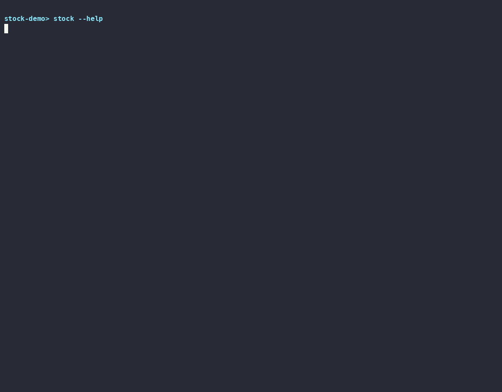

<!-- AI_GENERATE_START----------------------------------------------------------------------------------------------------------------- -->
<div align="center">

# stock-trading

**独立部署的 A 股 T+1 量化研究与自动交易系统**

从行情数据、模型训练、股票排名到实盘交易、订单结算与收益复盘，以一组清晰的命令完成完整交易闭环。

[文档工作台](http://117.72.216.67/docs) · [项目源码](https://github.com/mwangli/stock-trading/tree/stock-trading) · [版本发布](https://github.com/mwangli/stock-trading/releases)

</div>

<p align="center">
  
</p>

> **独立运行**：本项目不依赖 Web 服务即可部署和完成交易闭环。`stock-web` 只是可选的可视化增强模块，不参与本项目的数据、模型与交易执行。

## 核心能力

- **数据准备**：采集股票基础信息、日线、复权因子与分钟行情，沉淀为本地 Parquet 与 Qlib 数据。
- **模型研究**：完成特征准备、模型训练、评估、回测与版本化管理。
- **排名交易**：生成完整横截面排名，按 T+1 规则执行持仓轮换、买入与卖出。
- **订单闭环**：同步券商成交事实，结算已完成交易并汇总真实已实现收益。
- **复盘维护**：依据月度表现判断模型状态，配套数据清理和本地/服务器同步能力。

## 命令

所有能力使用同一个入口：

```text
stock <action> [options]
```

| 类型 | 命令 |
| --- | --- |
| 数据 | `data-collect`、`data-generate` |
| 模型 | `model-prepare`、`model-train`、`model-rank`、`model-evaluate` |
| 交易 | `trade-buy`、`trade-sell` |
| 券商 | `broker-check`、`broker-sync` |
| 运维 | `system-clean`、`system-pull`、`system-push` |

查看完整参数：

```bash
stock --help
stock data-collect --help
stock trade-buy --help
```

## 完整交易闭环

```text
行情采集 -> derived 数据生成 -> Qlib 数据准备 -> 模型训练与回测 -> 横截面排名
        -> 卖出 / 买入 -> 券商订单同步 -> 已实现收益 -> 模型复盘
```
模型命令不再通过 `--model` 选择模型：`model-prepare` 准备全部数据集，`model-train` 训练全部已配置模型；`model-rank`、`trade-buy`、`trade-sell`、`model-evaluate` 使用 `.env` 中的 `STOCK_TRADING_ACTIVE_MODEL`。
数据处理分为三个阶段：

- `data-collect`：采集并保存外部行情等 raw 原始数据。
- `data-generate`：基于 raw 数据生成可复用的 derived 派生数据，例如股票、日线、基础指标、复权因子和分钟汇总数据。
- `model-prepare`：只读取 derived 数据，转换为模型使用的 Qlib 数据，不直接依赖 raw 数据。

系统将模型评分与交易执行分离：模型负责排名，确定性规则负责候选筛选、持仓轮换、价格与数量计算、T+1 时序、幂等恢复和订单状态跟踪。交易完成后，再以券商成交事实结算收益并进入下一轮复盘。

## 消息推送

配置 `DEVICE_KEY` 后，交易执行结果和系统异常会推送到移动端。消息包含任务、时间、原因和诊断线索，便于在离开服务器时快速了解运行状态；推送失败只记录本地警告，不改变原任务结果。

## 快速开始

项目支持 Python `3.11-3.12`，推荐使用 Python 3.12。

```powershell
uv python install 3.12
uv venv --python 3.12 .venv
uv pip install --python .venv\Scripts\python.exe -e .
.venv\Scripts\activate
stock --help
```

Ubuntu 使用同一个入口：

```bash
uv venv --python 3.12 .venv
uv pip install --python .venv/bin/python -e .
source .venv/bin/activate
stock --help
```

项目可通过 Cron 串行调度数据更新、排名、交易、订单同步、复盘和清理任务，也可以按需手动执行。

## 自动补全

补全不是 `stock` 的业务动作，而是部署脚本提供的 Shell 配置。

- Windows PowerShell 7：点源 `.github/script/stock-completion.ps1`，或将点源命令加入 `$PROFILE`。
- Ubuntu：发布安装脚本会复制 Bash 补全并自动加入当前用户的 `~/.bashrc`。
- PowerShell 已将 Tab 设置为候选菜单，输入 `stock model-train --` 后可直接看到全部参数。

服务器部署完成后重新登录，或执行：

```bash
source ~/.bashrc
```

## 技术概览

`Python` · `Typer` · `Qlib` · `LightGBM` · `Parquet` · `SQLite`

运行数据、模型制品和交易状态均保存在本地目录中；实时资金、持仓、委托与成交结果以券商返回为准。

## 项目边界

- 本项目专注数据、模型、排名、交易、结算与复盘，不包含 Web 页面。
- Web 控制台可作为独立的只读可视化增强模块接入，但不是安装、部署或运行前提。
- 模型输出不等于成交结果，任何真实交易仍需满足券商权限、资金、价格与市场规则。
- 本项目用于技术研究与自动化验证，不构成投资建议。

<!-- AI_GENERATE_END------------------------------------------------------------------------------------------------------------------ -->
