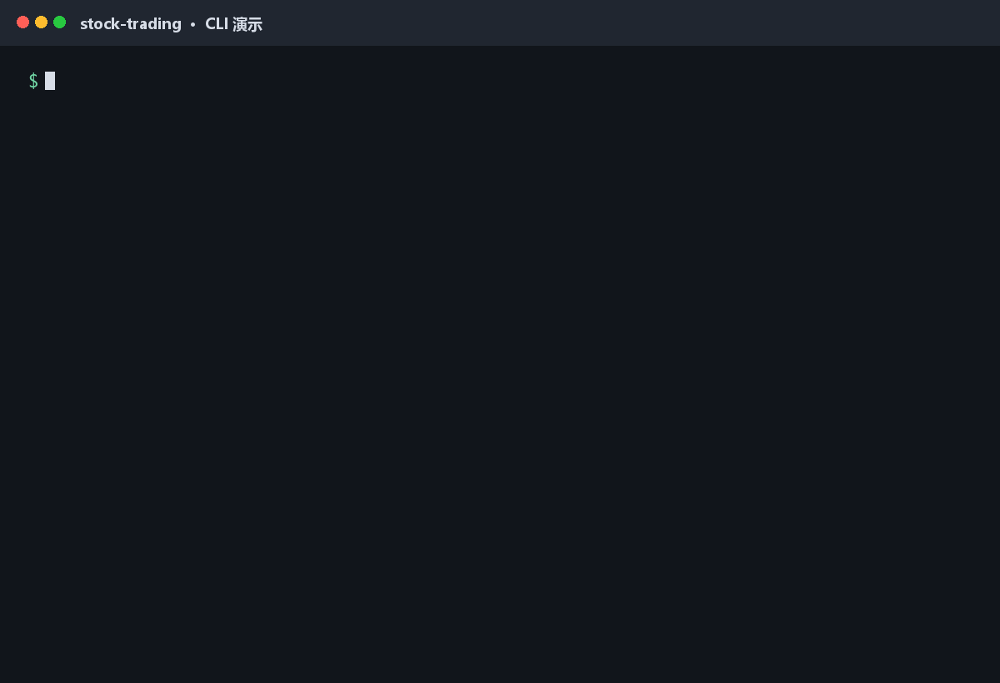

<!-- AI_GENERATE_START--------------------------------------------------------------------------------------------------------------- -->
<div align="center">

# stock-trading

**独立部署的 A 股 T+1 量化研究与自动交易系统**

从行情数据、模型训练、股票排名到实盘交易、订单结算与收益复盘，以一组清晰的命令完成完整交易闭环。

[文档工作台](http://117.72.216.67/docs) · [项目源码](https://github.com/mwangli/stock-trading/tree/stock-trading) · [版本发布](https://github.com/mwangli/stock-trading/releases)

</div>

> **独立运行**：`stock-trading` 不依赖 Web 服务即可部署和完成交易闭环。`stock-web` 只是可选的可视化增强模块，不参与本项目的数据、模型与交易执行。

## 核心能力

- **数据准备**：采集股票基础信息、日线、复权因子与分钟行情，沉淀为本地 Parquet 与 Qlib 数据。
- **模型研究**：完成特征准备、模型训练、评估、回测与版本化管理。
- **排名交易**：生成完整横截面排名，按 T+1 规则执行持仓轮换、买入与卖出。
- **订单闭环**：同步券商成交事实，结算已完成交易并汇总真实已实现收益。
- **复盘维护**：依据月度表现判断模型状态，配套数据清理和本地/服务器同步能力。

## 命令总览

<p align="center">
  
</p>
<p align="center"><sub>真实命令输出：一级命令补全、参数补全、根帮助和交易命令帮助。</sub></p>

| 阶段 | 命令 | 作用 |
| --- | --- | --- |
| 数据 | `stock-trading collect` | 依次采集基础、复权、日线、5 分钟和 1 分钟行情 |
| 模型 | `stock-trading prepare` | 增量、幂等准备 Qlib 数据 |
| 模型 | `stock-trading train` | 训练、评估并回测模型 |
| 排名 | `stock-trading rank` | 生成指定交易日的完整横截面排名 |
| 交易 | `stock-trading trade --buy / --sell` | 在独立窗口执行买入或卖出 |
| 订单 | `stock-trading order` | 同步券商事实并结算交易闭环 |
| 复盘 | `stock-trading review` | 汇总已实现收益并判断模型状态 |
| 维护 | `stock-trading clean / sync` | 清理历史数据或同步运行资产 |
| 汇报 | `stock-trading report` | 汇总数据、模型和最近 10 条闭环交易 |

## 完整交易闭环

```text
行情采集 -> Qlib 数据 -> 模型训练与回测 -> 横截面排名
        -> 卖出 / 买入 -> 券商订单同步 -> 已实现收益 -> 模型复盘
```

系统将模型评分与交易执行分离：模型负责排名，确定性规则负责候选筛选、持仓轮换、价格与数量计算、T+1 时序、幂等恢复和订单状态跟踪。交易完成后，再以券商成交事实结算收益并进入下一轮复盘。

## 消息推送

配置 `DEVICE_KEY` 后，交易执行结果和系统异常会推送到移动端。消息包含任务、时间、原因和诊断线索，便于在离开服务器时快速了解运行状态；推送失败只记录本地警告，不改变原任务结果。

## 快速开始

项目支持 Python `3.11-3.12`，推荐使用 Python 3.12。

```cmd
uv python install 3.12
uv venv --python 3.12 .venv
uv pip install --python .venv\Scripts\python.exe -e .
.venv\Scripts\activate
stock-trading -h
```

安装完成后执行一次补全安装，然后重新打开终端：

```bash
stock-trading --install-completion
```

该命令在 Windows 安装 PowerShell 补全，在 Linux 安装 Bash 补全；重复执行不会重复写入配置。IDEA 内置终端同样使用其实际 shell 的配置。也可以通过 `--print-completion` 输出脚本，交给自定义 shell 配置管理。

根命令和每个子命令都支持 `-h`：

```bash
stock-trading -h
stock-trading prepare -h
stock-trading trade -h
stock-trading report -h
```

Linux 部署使用虚拟环境中的同名命令。项目可通过 Cron 串行调度数据更新、排名、交易、订单同步、复盘和清理任务，也可以按需手动执行。

## 技术概览

`Python` · `argparse` · `shtab` · `Qlib` · `LightGBM` · `Parquet` · `SQLite`

运行数据、模型制品和交易状态均保存在本地目录中；实时资金、持仓、委托与成交结果以券商返回为准。

## 项目边界

- 本项目专注数据、模型、排名、交易、结算与复盘，不包含 Web 页面。
- Web 控制台可作为独立的只读可视化增强模块接入，但不是安装、部署或运行前提。
- 模型输出不等于成交结果，任何真实交易仍需满足券商权限、资金、价格与市场规则。
- 本项目用于技术研究与自动化验证，不构成投资建议。

<!-- AI_GENERATE_END---------------------------------------------------------------------------------------------------------------- -->
