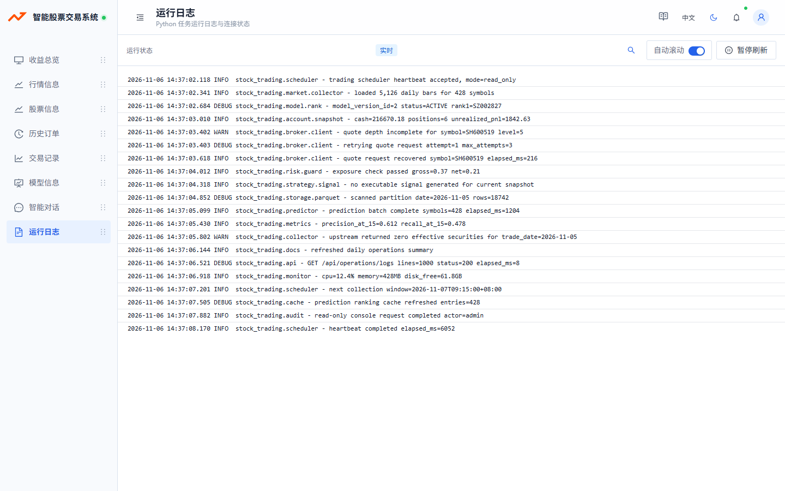
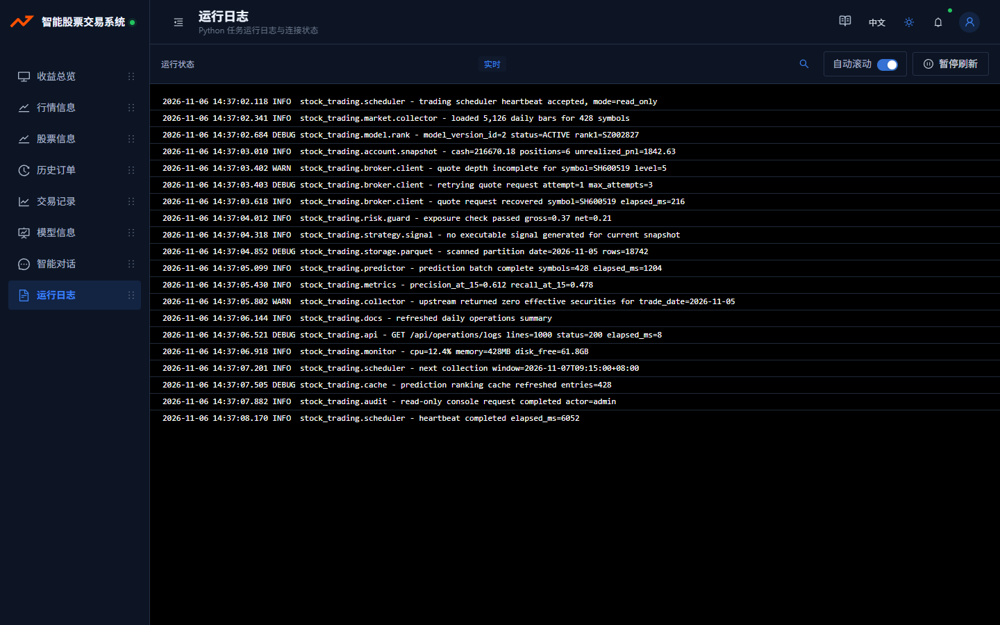
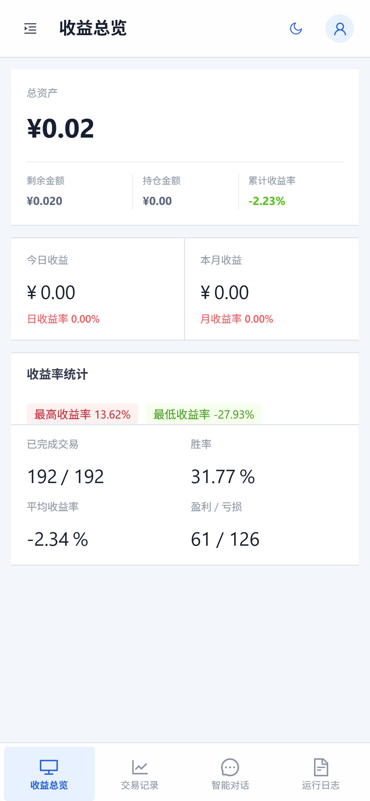
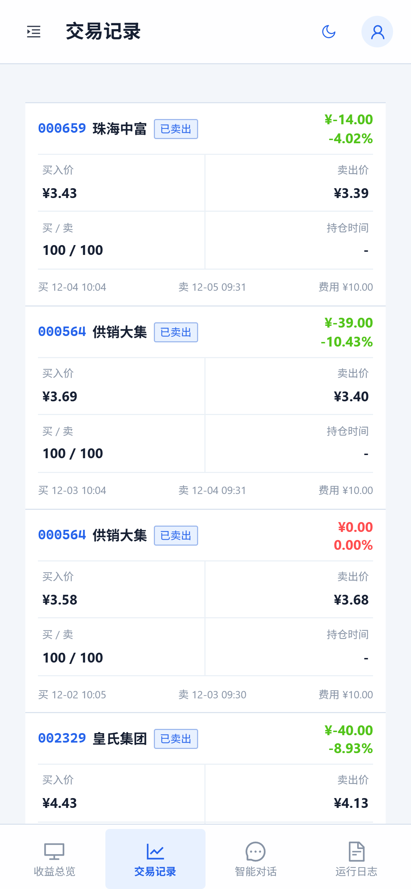
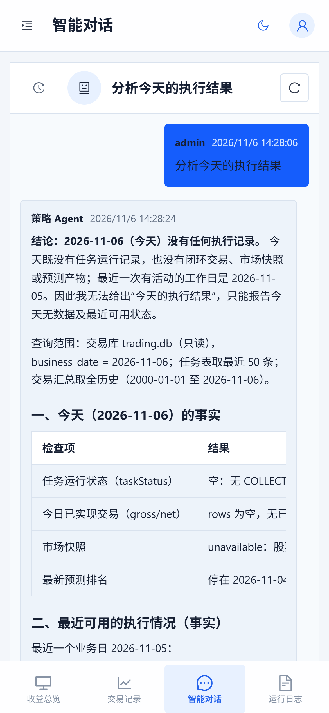
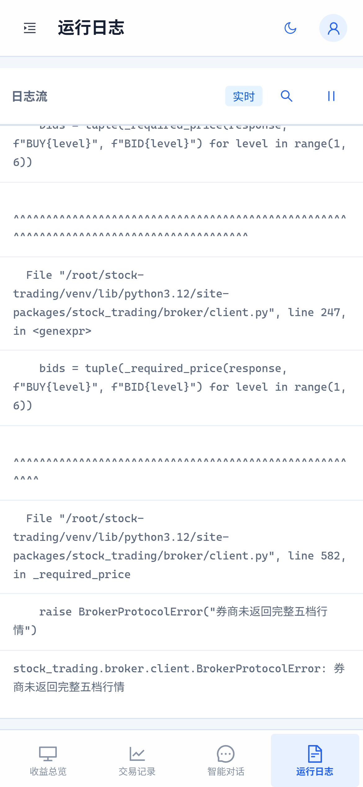

<!-- AI_GENERATE_START---------------- -->
# 智能股票交易系统

面向个人量化交易场景的只读 Web 控制台，将账户收益、市场行情、交易记录、模型预测、运行状态与 Agent 智能分析集中在一个简洁的工作台中。

  <a href="http://117.72.216.67/"><strong>在线体验：117.72.216.67</strong></a>

> 支持 PC 与移动端自适应访问。当前为个人项目演示环境，需要登录后使用。

## PC 端工作台

桌面端提供完整导航与高信息密度视图，适合持续观察账户表现、模型结果和系统运行情况。

  

深色主题适合长时间查看任务运行状态与实时日志。

  

## Agent 智能对话

Agent 不是脱离业务数据的通用聊天机器人，而是基于交易数据库、任务状态、模型结果和项目文档进行只读分析：

- 分析当天是否产生任务、预测与交易结果。
- 解释没有生成信号或执行记录的具体原因。
- 给出查询范围、数据日期和事实来源，避免脱离数据回答。
- 保持分析与真实交易执行隔离，不生成可审批的交易计划。

## 移动端体验

移动端聚焦高频查看场景，通过底部导航快速切换收益、交易、Agent 对话和运行日志。

<table>
  <tr>
    <td width="25%" align="center"><strong>收益总览</strong></td>
    <td width="25%" align="center"><strong>交易记录</strong></td>
    <td width="25%" align="center"><strong>Agent 智能分析</strong></td>
    <td width="25%" align="center"><strong>运行日志</strong></td>
  </tr>
  <tr>
    <td width="25%" valign="top"></td>
    <td width="25%" valign="top"></td>
    <td width="25%" valign="top"></td>
    <td width="25%" valign="top"></td>
  </tr>
</table>

## 核心能力

- **收益总览**：集中查看账户资产、阶段收益、胜率与历史表现。
- **行情与股票信息**：浏览股票目录、历史行情与关键市场数据。
- **交易记录**：按订单、成交和持仓维度回看策略执行结果。
- **模型与预测**：查看模型版本、预测排名和评估结果。
- **Agent 智能分析**：基于真实只读数据分析执行情况、异常和策略表现。
- **运行日志与文档**：追踪任务状态、实时日志，并在控制台内查阅项目文档。

## 项目定位

本项目是 Python T+1 交易系统的可视化入口。Python 负责行情、模型、交易与绩效计算；Web 控制台只读取既有数据，不触发训练、下单或状态修改。

这种边界让日常观察更直观，同时保持交易核心链路独立、可控。

## 技术概览

前端使用 React、TypeScript 与 Vite 构建响应式体验；后端使用 Spring Boot 提供只读聚合接口；DuckDB 负责统一查询 SQLite 与 Parquet 数据。

~~~text
Python 交易系统 -> SQLite / Parquet / Logs -> Spring Boot -> React Web
~~~

## 本地启动

~~~bash
# 前端
cd stock-client
npm install
npm run dev

# 后端
mvn -pl stock-server spring-boot:run
~~~

运行前需要配置控制台登录密码哈希与 Python 交易系统数据目录。详细配置、数据契约和部署说明统一维护在 [documents](documents/) 中。

## 安全边界

- 控制台只读访问交易数据，不修改或迁移交易数据库。
- Java 服务不调用券商、训练流程或 Python CLI。
- Agent 回答必须基于可追溯的数据或文档来源。
- GitHub 开发能力与交易数据、券商接口完全隔离。

## License

本项目许可证见 [LICENSE.txt](LICENSE.txt)。
<!-- AI_GENERATE_END---------------- -->
