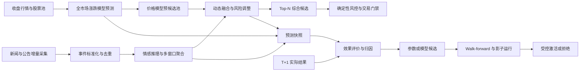

<!-- AI_GENERATE_START- -- -->
# 情感与涨跌模型综合预测及反馈迭代设计

## 1. 文档信息

| 项目 | 内容 |
|---|---|
| 设计日期 | 2026-10-13 |
| 设计状态 | 待实施 |
| 适用范围 | 全市场每日涨跌预测、新闻情感分析、综合选股、效果评价和模型反馈迭代 |
| 运行边界 | Java 17、DJL、PyTorch Engine、Spring Boot、Quartz、MongoDB、MySQL |
| 设计原则 | 数据先于模型、预测与交易分离、反馈可追溯、候选与激活分离、异常默认阻断 |

## 2. 目标与边界

本方案解决以下问题：

1. 每个交易日如何按固定信息截止点完成新闻增量采集、涨跌预测、情感预测和综合候选生成。
2. 如何判断现有新闻数据是否满足情感预测，而不是把“数据库有数据”误判为“数据完整可用”。
3. 如何让涨跌模型和情感模型协同工作，同时避免固定 50%/50% 权重放大低覆盖、低置信度情感信号。
4. 如何形成每日效果评论、T+1 结果回填、模型归因和策略参数评价。
5. 如何自动提出模型或参数候选，并通过样本外验证、影子运行、门禁和回滚完成受控迭代。

本方案不允许模型直接下单，不允许生产任务在线修改模型权重，不允许根据单日盈亏即时调整策略，不允许训练成功后自动覆盖当前生产版本。

## 3. 线上现状与结论

### 3.1 生产快照

以下数据来自 2026-10-13 线上运行环境的只读检查，属于当日快照，不代表长期稳定水平：

| 检查项 | 线上结果 | 结论 |
|---|---:|---|
| 股票基础信息 | 4,619 只 | 具备全市场任务规模 |
| `stock_news` 总量 | 约 51.27 万条 | 已有历史基础，但不能按文档数直接判断有效样本量 |
| 最近 36 小时发布且本轮已入库 | 1,717 条 | 新闻和公告均有新增 |
| 最近 36 小时有数据的股票 | 940 只，约占 20.4% | 可覆盖有事件股票，但不是全市场均匀覆盖 |
| 覆盖股票平均记录数 | 1.83 条 | 大多数股票只有少量事件，适合事件确认，不适合简单按篇数比较 |
| 最近 36 小时至少 3 条 | 163 只 | 中高事件密度股票占比较低 |
| 最近 36 小时至少 5 条 | 51 只 | 高密度新闻只集中于少量股票 |
| 最近记录正文缺失 | 0 条 | 本轮有效记录正文完整 |
| 主要来源 | 交易所、开利财经、券商研究来源 | 公告质量较高，但来源多样性和直接监管来源仍需增强 |
| 06:00 新闻任务耗时 | 约 57 分钟 | 已越过 06:15 预测和 06:30 选股时点 |
| 06:15 每日预测 | 当日定时任务失败 | 预测幂等和任务依赖仍需治理 |
| 最近已评估批次 | 4,576 条有效评价 | 已具备基础回填能力 |
| 最近批次方向准确率 | 77.88% | 可能受市场共同方向影响，不能单独证明选股有效 |
| 最近批次 Spearman Rank IC | -0.0463 | 横截面排序暂未体现正向能力 |
| 最近批次 Top 10% 实际平均收益 | -1.84% | 当前高分股票表现不达标，能力等级为 `WEAK` |
| 最新重跑批次 | 4,597 成功、22 失败 | 覆盖率较高，但仍需分析失败股票并完成目标日评价 |

### 3.2 新闻数据是否满足需求

现有数据**部分满足基础情感确认，尚不满足完整自迭代需求**。

已满足的部分：

- 已采集新闻和公告的标题、正文、股票代码、来源、分类、发布时间和入库时间。
- 最近事件可以按股票和时间窗口查询。
- 当前聚合已具备模型置信度、时间衰减、来源权重、事件类型权重、转载惩罚和强负面标志。
- 交易所公告占比较高，适合风险事件确认。

尚未满足的部分：

- 没有每只股票、每个来源的同步水位，无法区分“确实没有新闻”和“任务尚未同步到该股票”。
- 当前每日任务仍扫描全部股票，每只股票请求新闻和公告列表；即使没有新增数据，也需要约 9,238 次列表请求。
- 单次任务会混入历史补采和当日增量，`createTime` 不能直接代表新闻时效性。
- 同一事件跨股票、跨来源的去重能力有限，当前标题指纹不能覆盖改写标题和摘要转载。
- 情感推理结果未作为不可变事件特征缓存，同一新闻可能在不同任务中重复推理。
- 综合候选未完整保存情感置信度、事件数量、数据水位、强负面原因和策略配置版本，无法进行严格归因。
- 当前数据来自单一证券平台入口，媒体字段虽多样，但上游通道仍存在单点和漏采风险。
- 缺少人工复核标签、事件类型标签和冻结测试集，不能直接用现有新闻正文自动微调情感模型。

因此，近期可将情感模型用于候选确认、有限增减分和强负面阻断；在补齐同步水位、事件缓存、结果归因和人工标签前，不将其作为全市场主排序模型，也不启动自动微调上线。

## 4. 推荐总体架构

架构采用两阶段候选模式：涨跌模型先对全市场进行低成本排序，新闻采集和情感推理重点覆盖持仓、风险关注股票及价格模型预候选池。这样既保留全市场发现能力，又避免每天对全部股票执行高成本新闻详情和情感推理。

## 5. 每日预测流水线

### 5.1 推荐时间表

| 时间 | 任务 | 输出与门禁 |
|---|---|---|
| 前一交易日 16:00 后 | 收盘行情、复权和交易日历同步 | 最新交易日、完整股票池和行情水位 |
| 04:50 | `predictionDataReadiness` | 校验行情、激活模型、模型制品和数据库状态 |
| 05:00 | `newsPriorityIncrementalSync` | 同步持仓、未完成订单、风险名单、上一日候选和近期活跃股票 |
| 05:05 | `dailyModelPrediction` | 全市场涨跌预测，生成价格模型预候选 Top 300 |
| 05:15 | `newsCandidateIncrementalSync` | 补充 Top 300 预候选的新闻和公告增量 |
| 05:30 | `dailySentimentPrediction` | 生成 6/12/24/36 小时事件情感快照 |
| 05:45 | 信息冻结点 | 冻结本轮行情、新闻水位、模型版本和策略配置版本 |
| 05:50 | `dailyFusionPrediction` | 生成价格模型、情感模型和融合模型三套可对比结果 |
| 06:00 | `predictionPublishAudit` | 检查覆盖率、失败比例、异常分布和强负面事件 |
| 06:15 | 补偿窗口 | 只重试失败股票和缺失来源，不重新扫描全部股票 |
| 06:30 | 候选发布截止 | 门禁通过后发布候选；未通过则阻断自动买入 |
| 下一次 06:15 统一任务 | `dailyModelPrediction` | 先补齐预测，再回填已具备目标日行情的历史结果并生成效果评论 |
| 每周末 | 周度归因与候选参数生成 | 只生成候选配置，不直接激活 |
| 每月 | 模型再训练与 Champion/Challenger 评估 | 达标候选进入影子运行 |

所有任务继续通过 `JobConfig + JobSchedulerService` 接入 Quartz，禁止新增 `@Scheduled`。任务之间不能只依赖 Cron 时间间隔，必须读取上游批次状态和数据水位。

### 5.2 数据就绪门禁

每日融合前必须同时满足：

- 最新行情日期等于预期基准交易日。
- 涨跌模型、情感模型均绑定唯一可追溯版本。
- 优先股票池新闻同步完成率不低于 99%。
- Top 300 预候选同步失败率不高于 1%，失败股票不得进入最终候选。
- 每条新闻保存发布时间、入库时间、来源和同步批次。
- 新闻水位早于信息冻结点不超过 15 分钟。
- 情感推理失败率不高于 0.5%；出现系统性失败时阻断整批融合。
- 综合候选必须保存策略配置版本和完整输入快照。

“无新增新闻”必须记录为 `SUCCESS_NO_CHANGE`，不能使用空集合同时表示无新闻、未执行、超时和失败。

## 6. 新闻增量同步优化

### 6.1 当前耗时根因

当前实现对全部股票逐一拉取两个来源列表，再判断 `externalId` 是否已存在。每日新增量虽小，但远程列表请求数量仍与股票数线性增长，主要成本是网络往返、上游限流、连接复用不足和全市场无差别轮询，而不是 MongoDB 写入。

### 6.2 优先级分层

| 优先级 | 股票范围 | 同步频率 | 交易处理 |
|---|---|---|---|
| P0 | 当前持仓、未完成订单、风险关注名单 | 每日 05:00，必要时盘中补充 | 强负面直接进入风控 |
| P1 | 涨跌模型 Top 300 预候选、上一日 Top-N | 每日 05:15 | 允许参与综合候选 |
| P2 | 近 30 日有新闻、公告或异常波动股票 | 每日或隔日 | 用于扩大候选和监控 |
| P3 | 长期无事件的其余股票 | 分片轮询，周内覆盖 | 未刷新时只保留价格模型结果，不进入自动买入 Top-N |

P0、P1 必须每日新鲜；P2、P3 用于市场覆盖和历史积累。最终自动买入候选只能来自当日完成新闻水位确认的股票。

### 6.3 股票级同步水位

第一阶段直接在 MySQL `stock_info` 增加股票级新闻同步水位，避免为当前两个来源过早建设独立状态表。最小字段如下：

| 字段 | 含义 |
|---|---|
| `news_last_attempt_at` | 最近一次开始或尝试同步的时间 |
| `news_last_success_at` | 新闻和公告两个来源最近一次全部同步成功的完成时间 |
| `news_last_publish_time` | MongoDB 中该股票已知新闻和公告的最大 `publishTime` |
| `news_sync_status` | `NEVER_SYNCED`、`RUNNING`、`SUCCESS_WITH_CHANGE`、`SUCCESS_NO_CHANGE`、`PARTIAL` 或 `FAILED` |
| `news_sync_batch_id` | 最近同步批次 ID，用于关联任务记录和日志 |
| `news_sync_error_code` | 最近失败或部分失败的标准错误码；成功时清空 |
| `news_consecutive_no_change_count` | 连续无新增次数，用于空更新退避 |
| `news_next_sync_at` | 根据优先级和退避规则计算的下次允许同步时间 |

同步状态按以下规则更新：

1. 任务开始时更新 `news_last_attempt_at`、批次 ID 和 `RUNNING`。
2. 新闻、公告两个来源都成功后更新 `news_last_success_at`；有新增记录时为 `SUCCESS_WITH_CHANGE`，无新增时为 `SUCCESS_NO_CHANGE`。
3. `news_last_publish_time` 取本次完成后 MongoDB 中该股票最大 `publishTime`，不能使用本地入库时间代替。
4. 任一来源失败时标记 `PARTIAL`，全部失败时标记 `FAILED`，并且不得把本次尝试时间当作成功水位。
5. 字段为空或状态为 `NEVER_SYNCED` 表示尚未完成过同步；最近成功时间过旧表示数据已过期。
6. MongoDB 新闻写入成功后再更新 MySQL 水位。MySQL 更新失败时保留旧水位，使下次任务重新扫描；允许重复检查，不允许误判为无新闻。

这样可以明确区分：从未同步、正在同步、同步成功且有新增、同步成功但无新增、部分失败和全部失败。若后续接入更多独立新闻源，再拆分 `stock_news_sync_state` 表保存每股票、每来源水位；`stock_info` 保留聚合后的交易就绪状态。

若上游支持按发布时间或全局事件流拉取，优先改为全局游标增量，再按关联股票分发；如果上游只支持逐股列表，则使用以下降本策略：

1. 已连续多日无新增的 P2/P3 股票采用指数退避，最长不超过 5 个交易日。
2. P0/P1 每日必查，发现新 `externalId` 后才请求详情。
3. HTTP 客户端启用连接池、Keep-Alive、明确超时和限速器。
4. 并发度改为运行配置，并依据上游限流、失败率和服务器资源动态选择，不能无上限增加线程。
5. 单股票处理失败进入补偿队列，不阻塞其他股票；重试只处理失败股票。
6. 每周低峰期执行全量对账，不在交易日早晨做历史补采。

### 6.4 同步性能目标

- P0/P1 增量同步 P95 小于 15 分钟。
- 全部优先股票池在 05:40 前完成。
- 无新增股票平均只发生列表请求，不发生详情请求和写入。
- 每日保存请求数、新增数、重复数、失败数、限流数和各阶段耗时。
- 历史补采与当日增量使用不同任务、不同批次类型和不同资源限额。

## 7. 情感模型每日预测

### 7.1 事件级推理缓存

情感模型不应在每次选股时重复读取正文并推理。首次识别新事件后保存不可变结果：

- `eventId` 和事件指纹版本
- 主新闻及关联转载 ID
- 关联股票列表
- 事件类型
- 发布时间、首次入库时间和最后更新时间
- 情感模型版本
- `positive/neutral/negative` 概率
- 零中心情感分数
- 模型置信度
- 强负面标志及命中规则
- 推理时间和异常信息

模型版本升级时生成新版本情感结果，不覆盖历史推理。

### 7.2 多窗口聚合

每只股票生成 6、12、24、36 小时聚合特征：

- 加权情感分数
- 情感置信度
- 原始新闻数
- 唯一事件数
- 公告数和新闻数
- 强负面事件数
- 最新事件年龄
- 数据同步状态
- 来源覆盖度

无新闻时情感分数为 0，但必须同时输出 `coverageConfidence=0` 和明确的 `NO_EVENT` 状态。无新闻不是正面或中性证据，也不能被映射成固定 0.5 后占据一半综合权重。

## 8. 涨跌模型与情感模型协同策略

### 8.1 职责划分

- 涨跌模型负责全市场横截面主排序，输出预期超额收益、上涨概率、下行风险和模型置信度。
- 情感模型负责事件方向、时效性、来源可靠度和重大风险确认。
- 融合策略负责受控增减分、置信度折扣和强负面否决。
- Java 风控负责可交易性、仓位、资金、T+1、涨跌停、重复委托和券商状态。

### 8.2 融合公式

先将涨跌模型输出转换为横截面可比较的 `priceScore`：

`priceScore = returnRank × 0.55 + directionProbability × 0.30 + (1 - downsideRisk) × 0.15`

情感增量使用零中心分数：

`sentimentAdjustment = sentimentScore × coverageConfidence × sourceReliability × regimeWeight`

最终分数：

`fusionScore = priceScore + sentimentWeight × sentimentAdjustment - dataPenalty - riskPenalty`

关键约束：

- 初始 `sentimentWeight` 建议为 0.10 至 0.20，不再使用固定 0.50。
- `coverageConfidence < 0.25` 时情感调整为 0，只记录数据不足。
- 正面情感单次最多提高 0.05，不能把弱价格候选直接提升为强买入。
- 负面情感最多降低 0.15；可信来源强负面事件直接否决买入。
- 情感与价格信号冲突时降低综合置信度，不自动选择更乐观的一方。
- 所有阈值按策略配置版本保存，禁止运行中无版本修改。

### 8.3 初始策略配置

| 配置项 | 初始值 | 说明 |
|---|---:|---|
| 价格预候选数量 | 300 | 控制新闻同步和情感推理规模 |
| 最终候选数量 | 10 | 与现有自动交易候选规模一致 |
| 情感基础权重 | 0.15 | 作为价格模型的增量修正 |
| 情感最低覆盖置信度 | 0.25 | 低于该值不参与增减分 |
| 高置信度阈值 | 0.65 | 用于显著事件和效果分层 |
| 正面最大增益 | 0.05 | 防止媒体热度替代价格能力 |
| 负面最大扣分 | 0.15 | 负面风险优先于正面增强 |
| 强负面处理 | 否决买入 | 仅限可信来源和明确事件规则 |
| 数据过期阈值 | 15 分钟 | 超过阈值视为同步未就绪 |

初始值只用于影子运行，必须通过至少 20 个交易日的同口径对照后才能用于真实交易。

## 9. 每日效果评论

每日评价不只输出“准确率”，而应生成结构化评论：

### 9.1 当日预测评论

- 数据是否按时就绪，哪些来源或股票同步失败。
- 涨跌模型版本、情感模型版本和策略配置版本。
- 价格模型 Top 300 的分布、异常值和置信度。
- 情感覆盖股票数、事件数、强负面数和主要来源。
- 情感模型使哪些股票进入或退出 Top-N，以及调整原因。
- 最终候选的价格信号、情感信号、融合分数和风险结论。
- 是否满足自动交易门禁；不满足时给出阻断原因。

### 9.2 实际结果评论

在实际行情形成后，对价格模型、情感模型和融合模型分别评价：

| 评价层 | 核心指标 |
|---|---|
| 数据层 | 新闻及时率、优先池覆盖率、正文完整率、重复率、来源分布、任务耗时 |
| 价格模型 | MAE、RMSE、方向准确率、Pearson IC、Spearman Rank IC、Top-K 超额收益 |
| 情感模型 | 高置信度事件方向命中、强负面精确率/召回率、不同来源和事件类型的增量收益 |
| 融合策略 | 相对价格模型的 Top-K 收益增量、换手变化、最大回撤、候选替换贡献 |
| 交易层 | 实际成交率、滑点、手续费后收益、拒单和风控拦截分布 |

评论等级分为：

- `HEALTHY`：数据完整，融合相对基线稳定增益。
- `OBSERVE`：链路可用，但样本少或单日指标波动较大。
- `DEGRADED`：排序、覆盖或数据时效低于门槛，降低情感权重或停止发布。
- `BLOCKED`：模型、数据或风控关键门禁失败，禁止自动交易。

单日结果只能形成观察结论；模型能力结论至少使用 20、60、120 个交易日滚动窗口。

## 10. 反馈数据设计

每个最终候选必须保存不可变信号快照：

- 预测批次、基准日、目标日和信息截止时间
- 股票、行业和市场状态
- 涨跌模型版本及四项原始输出
- 新闻同步批次和数据水位
- 情感模型版本及多窗口聚合结果
- 强负面规则和事件 ID
- 融合策略配置版本
- `priceScore`、`sentimentAdjustment`、`fusionScore`
- 入选、降权、否决或未入选原因
- 风控结论和交易回执

实际结果只强制按 T+1 交易日回填：

- T+1 绝对收益和相对基准超额收益
- T+1 日内最大有利变动和最大不利变动
- T+1 方向是否命中
- T+1 Top-K 排名表现
- T+1 是否可成交、实际成交价和滑点
- 情感调整是否对 T+1 结果带来正向增量

T+3、T+5 与当前 T+1 交易持有周期不一致，默认不采集、不进入生产评价和模型激活门禁。将来仅在研究新闻影响持续性时通过独立离线任务按需生成，且不得影响每日交易闭环。

不得覆盖原预测；实际结果和后续评价作为追加字段或独立评价文档保存。

## 11. 反馈调节与自我迭代

### 11.1 三层反馈闭环

**数据层反馈**：根据漏采、延迟、空正文、重复和来源稳定性调整采集优先级与退避周期，不修改模型参数。

**策略层反馈**：在历史不可变快照上离线比较不同情感权重、阈值和候选数量，生成候选策略配置。

**模型层反馈**：积累新标签后训练候选模型，通过固定测试集和 walk-forward 验证，不直接更新当前生产模型。

### 11.2 情感模型优化

情感模型训练标签以人工复核为主，价格反应只作为辅助标签：

- 优先抽取高置信度错误、低置信度高影响、价格与情感严重冲突、强负面规则命中和新事件类型样本。
- 保留新闻发布时间，按时间切分训练、验证和测试，禁止随机混洗造成未来泄漏。
- 同一事件及转载必须进入同一数据分区。
- 冻结测试集覆盖公告、处罚、诉讼、业绩、增减持、并购、政策和普通新闻。
- 当前建议至少积累 15,000 条人工复核样本，负面样本不少于 25%，再评估微调收益。

### 11.3 涨跌模型优化

- 每周分析失败股票、行业偏差、市场状态偏差和高置信度错误。
- 评价重点使用 Rank IC、Top-K 超额收益、回撤和扣费后收益，不以总体方向准确率单独决定上线。
- 新模型必须与当前 Champion 使用相同股票池、时间切分、成本和情感快照进行比较。
- 训练数据和标准化器、股票字典、行业字典、特征版本必须作为同一制品发布。

### 11.4 策略参数优化

参数搜索只允许在预先定义的小范围内执行，例如：

- 情感权重：0.05 至 0.25。
- 预候选数量：100 至 500。
- 最低覆盖置信度：0.20 至 0.50。
- 正面增益上限：0.02 至 0.08。
- 负面扣分上限：0.10 至 0.25。

优化目标必须同时包含收益、回撤、换手、稳定性和覆盖率，禁止只最大化历史收益。候选参数至少完成：

1. Walk-forward 样本外验证。
2. 不同市场状态分层验证。
3. 交易成本和滑点压力测试。
4. 20 个交易日影子运行。
5. 与当前配置的显著性和稳定性比较。

### 11.5 Champion/Challenger 激活门禁

候选模型或策略同时满足以下条件才允许激活：

- 样本外 Rank IC、Top-K 超额收益不低于当前版本。
- 最大回撤和高风险误判不恶化。
- 至少两个滚动窗口表现一致，不依赖单一市场阶段。
- 新闻覆盖、推理耗时和资源使用满足生产窗口。
- 影子运行无数据泄漏、任务失败和结果不可追溯问题。
- 已生成版本、指标、参数、数据范围和回滚指针。

第一阶段必须人工确认激活。后续若开放自动激活，也只能对连续多期达标且风险不恶化的候选执行，并保留即时回滚；训练成功本身永远不等于激活成功。

## 12. 异常与降级

| 异常 | 处理方式 |
|---|---|
| 新闻同步未完成 | 不发布涉及失败股票的融合候选；不得把未同步解释为无新闻 |
| 情感模型不可用 | 停止融合候选和自动买入，不使用规则情感冒充模型输出 |
| 个别新闻推理失败 | 隔离失败事件；超过 0.5% 阻断整批 |
| 涨跌模型失败 | 停止全市场候选生成 |
| 价格模型低置信度 | 不能依靠正面情感单独提升为买入候选 |
| 强负面来源不可信 | 只降权并进入人工复核，不直接否决 |
| 实际行情未就绪 | 评价任务等待数据水位，不提前标记模型失败 |
| 单日指标异常 | 标记观察，不自动调整生产参数 |
| 连续 5 日滚动指标恶化 | 冻结自动候选激活，回退上一稳定版本并启动归因 |
| 任务记录成功但无业务产物 | 任务判定为失败；业务结果必须反向决定调度状态 |

## 13. 实施阶段

### 阶段 0：修复每日闭环

- 新闻任务前移到 05:00。
- 修复预测幂等、旧索引迁移和失败批次重跑边界。
- 让选股业务失败能够正确传递到 Quartz 任务状态。
- 增加任务依赖和数据就绪门禁。
- 保存新闻同步水位和批次统计。

### 阶段 1：降低同步成本

- 实现 P0/P1/P2/P3 分层采集。
- 增加增量游标、空更新退避、失败补偿和连接池指标。
- 将历史补采与交易日增量拆分。
- 建立 05:40 完成的性能基线。

### 阶段 2：建立可归因融合

- 持久化事件级情感结果和多窗口聚合。
- 同时保存价格模型、情感模型和融合模型输出。
- 将固定 50%/50% 改为零中心、置信度感知的有限调整。
- 建立强负面可信来源门禁。

### 阶段 3：建立效果评论

- 只回填与当前交易周期一致的 T+1 结果。
- 增加价格、情感、融合和交易四层指标。
- 生成每日评论、周度归因和滚动能力报告。
- 页面展示信号变化和候选替换原因。

### 阶段 4：受控自我迭代

- 建立主动学习样本池和人工复核流程。
- 自动生成候选参数和候选模型。
- 完成 walk-forward、压力测试和影子运行。
- 通过 Champion/Challenger 门禁受控激活并保留回滚。

## 14. 验收标准

方案完成后至少满足：

1. 新闻优先池同步在 05:40 前完成，P95 小于 15 分钟。
2. 06:30 前形成唯一、可追溯的每日综合预测批次。
3. 任一候选可以还原行情版本、新闻事件、两个模型版本、策略配置和风控结论。
4. 无新闻、未同步、同步失败和推理失败四种状态可明确区分。
5. 价格模型、情感模型和融合策略可以独立评价，能够回答情感信号是否产生真实增益。
6. 每日效果评论包含数据、模型、融合和交易四层结论。
7. 参数和模型更新只生成候选版本，不根据单日结果直接修改生产策略。
8. 候选激活具有样本外证据、影子运行记录和上一版本回滚能力。
9. 调度任务状态与实际业务产物一致，不再出现“任务成功但没有候选结果”。
10. 真实交易继续受 Java 风控和现有写门禁控制，模型不能直接调用券商接口。
<!-- AI_GENERATE_END- -- -->
