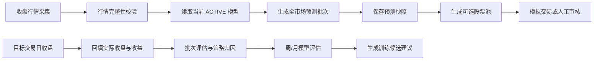

<!-- AI_GENERATE_START -->
# 涨跌预测模型缺陷、周期性优化与交易评估设计

## 1. 文档信息

| 项目 | 内容 |
|---|---|
| 文档日期 | 2026-10-16 |
| 文档状态 | 分析完成，待分阶段实施 |
| 适用范围 | 全市场涨跌预测、模型版本、训练快照、每日预测、T+1 回填、选股、盘中买入门禁 |
| 核心原则 | 模型版本长期稳定、训练周期性更新、每日预测不等于每日训练、评估先于交易、门禁失败默认不买入 |

## 2. 业务目标与不可承诺事项

系统需要在指定股票范围内，使用当前生效的涨跌模型生成下一交易日预测，并筛选出：

1. 上涨概率和预期收益具有横截面区分度的股票。
2. 预期收益能够覆盖手续费、滑点和安全边际的股票。
3. 经过连续历史回填和样本外评估后，具备进入模拟交易或真实交易的资格。
4. 每一笔候选和买入决策都能追溯到行情截止时间、模型版本、预测批次、策略版本和风险门禁结果。

模型不能保证每月收益率一定大于 0，也不能保证每只股票上涨。月平均收益率应定义为经过手续费、滑点和失败交易处理后的滚动样本外目标，而不是单日方向准确率或单个预测概率阈值。

## 3. 已完成的线上只读验证

本节记录 2026-10-16 对远程数据库的只读验证结果。没有执行数据库写操作、模型激活、训练触发或真实下单。

### 3.1 当前激活模型

| 项目 | 结果 |
|---|---|
| 模型 ID | `6acc52c6643b6156a8d1783a` |
| 模型版本 | `v3-embedding-multitask-1791775430969` |
| 创建时间 | 2026-10-12 |
| 最佳轮次 | 11 |
| 训练股票数 | 4596 |
| 训练样本数 | 73516 |
| 验证样本数 | 13786 |
| 训练损失 | 0.215336 |
| 验证损失 | 0.217513 |
| 模型状态 | `ACTIVE` |

### 3.2 最新预测批次

| 项目 | 结果 |
|---|---|
| 批次 ID | `6ad15064fd744801ceea7eb8` |
| 基准日 | 2026-10-14 |
| 目标日 | 2026-10-15 |
| 总股票数 | 4619 |
| 成功数 | 4580 |
| 失败数 | 39 |
| 评估状态 | `PENDING` |

| 指标 | 均值 | 标准差 | 最小值 | 最大值 |
|---|---:|---:|---:|---:|
| 上涨概率 | 47.5525% | 0.17096% | 47.2605% | 47.8676% |
| 下行风险 | 7.7069% | 0.06247% | 7.6541% | 7.8214% |
| 预测收益 | 0.04750% | 0.02425% | 0.01699% | 0.10808% |

当前结果不是页面保留两位小数导致的相等，而是模型本身输出接近常数。

### 3.3 历史回填结果

| 目标日 | 方向准确率 | 实际上涨数 | 模型预测上涨数 | Spearman Rank IC | Top 10% 实际收益 | 能力等级 |
|---|---:|---:|---:|---:|---:|---|
| 2026-10-14 | 92.45% | 346 / 4580 | 0 / 4580 | -0.04580 | -2.712% | `WEAK` |
| 2026-10-13 | 81.37% | 853 / 4578 | 0 / 4578 | -0.09560 | -1.338% | `WEAK` |
| 2026-10-12 | 44.86% | 2523 / 4576 | 0 / 4576 | 0.01346 | 0.270% | `WEAK` |
| 2026-10-11 | 77.88% | 1012 / 4576 | 0 / 4576 | -0.04634 | -1.843% | `WEAK` |

高方向准确率主要来自模型把所有股票判为下跌，恰好遇到全市场下跌日，并不代表模型能够选出上涨股票。当前模型不能用于真实买入。

### 3.4 训练快照新鲜度

| 项目 | 结果 |
|---|---|
| 快照 ID | `6acc490f643b6156a8d17834` |
| 快照创建时间 | 2026-10-12 |
| 数据截止日期 | 2026-10-08 |
| 股票数 | 4619 |
| 训练样本 | 73516 |
| 验证样本 | 13786 |

MongoDB 行情最新日期为 2026-10-14。当前模型训练数据落后最新行情，但这不意味着每天必须重新训练模型；它说明下一次周期性训练应创建新的训练快照，而不是继续复用旧快照。

## 4. 现有模型缺陷

### 4.1 输出塌缩，缺少股票区分度

当前模型的 `directionProbability` 和 `downsideRisk` 都集中在很窄区间，接近训练集先验。模型可能只学习了市场整体涨跌比例和下行风险均值，没有学到个股之间的差异。

直接后果：

- 方向概率无法有效区分候选股票。
- 预测收益排序被极小的数值噪声主导。
- Top-N 选股结果可能是随机排序或错误排序。
- 单边行情中的方向准确率会虚高。

### 4.2 训练目标存在类别和量纲问题

当前方向标签为下一交易日收益是否大于 0；下行风险标签为负收益幅度的缩放值。上涨标签、下行风险标签和收益标签的分布可能严重不平衡。下行风险不是下跌概率，而是负收益幅度风险。

### 4.3 综合损失不能证明选股有效

验证损失低于阈值不代表方向 AUC、概率校准、横截面排序、Top 10% 收益或扣除交易成本后的收益有效。候选准入必须加入常数基线、方向指标、概率校准、横截面排序和交易回测。

### 4.4 训练快照与模型版本职责混淆

训练快照是某一次训练使用的不可变数据工件，模型版本是训练得到的不可变参数工件。每日预测使用最新行情构造推理窗口，不加载训练快照；训练快照只在一次训练或周期性微调开始时构建；已激活模型可以连续使用数月。

### 4.5 样本不足以证明长期盈利

当前只有少数交易日的有效回填样本，不能用 1 至 4 个交易日推断月度收益，更不能直接推断真实交易盈利。
## 5. 模型长期生命周期设计

### 5.1 三类数据必须分开

| 数据类型 | 更新频率 | 作用 |
|---|---|---|
| 实时/最新行情 | 每个交易日或盘中 | 构造当日预测输入、执行风控和下单 |
| 训练数据快照 | 每次周期性训练时 | 固化训练样本，保证训练可复现 |
| 模型参数版本 | 每次训练完成后 | 保存候选、验证、影子运行和激活版本 |

### 5.2 不采用每日重训

本项目不采用每日重训。每日任务只执行：

1. 采集并校验最新行情。
2. 使用当前激活模型生成预测。
3. 保存预测批次和候选结果。
4. 到目标交易日结束后回填实际结果。
5. 更新模型能力评估和策略评估。

### 5.3 推荐训练周期

建议采用“长期稳定版本 + 周期性微调”的方式：

| 阶段 | 周期 | 动作 |
|---|---|---|
| 日常运行 | 每交易日 | 只预测、回填、评估，不训练 |
| 观察期 | 每周 | 汇总最近 5 至 20 个交易日指标，生成训练建议，不自动训练 |
| 微调候选 | 每月或每 2 个月 | 基于现有激活模型 warm start，构建新快照并训练候选 |
| 中期重训 | 每季度或半年 | 全量重建快照，从头训练或与旧模型做 Champion/Challenger 对比 |
| 紧急重训 | 按需 | 数据口径、特征、标签或模型结构发生变更时执行 |

实际周期由样本量、市场状态和评估结果决定。模型连续稳定时可以使用数月；模型只有在候选版本样本外表现显著优于当前版本时才允许替换。

### 5.4 训练快照复用规则修订

“快照距离最新行情超过 1 个交易日时强制重建”只适用于**开始新的训练任务时**，不适用于每日预测。

修订后的规则：

1. 日常预测不读取训练快照，不因快照日期旧而阻断预测。
2. 新训练任务开始时，检查当前快照的 `datasetEndDate`。
3. 如果该训练任务要求使用最新数据，且快照落后超过 1 个交易日，则新建快照。
4. 如果任务明确是历史复现实验，可以复用旧快照，但必须记录 `snapshotId` 和数据截止日期。
5. 当前激活模型继续保持不变，直到新候选完成样本外验证和激活审批。

## 6. 每日数据采集、预测与回填流程

### 6.1 每日生产流程



### 6.2 数据采集门禁

预测前必须记录并校验：

- 预期基准交易日；
- 行情最新日期；
- 股票池总数；
- 有效行情股票数；
- 缺失行情股票数及原因；
- 当前模型 ID、模型版本和激活时间；
- 特征版本、标签版本和策略版本；
- 预测信息截止时间。

数据未达到门禁时，批次可以记录为 `BLOCKED` 或 `PARTIAL`，但不能把缺失股票当作模型看跌，也不能进入自动买入池。

### 6.3 预测批次

每个预测批次必须保存：

- `batchId`；
- `baseTradeDate`；
- `targetTradeDate`；
- `modelId` 和 `modelVersion`；
- `strategyConfigVersion`；
- `informationCutoffAt`；
- 预测成功数、失败数和失败原因；
- 每只股票的预测收益、上涨概率、风险指标和数据质量状态。

任何后续评估必须按具体 `batchId` 进行，禁止只读取“最新批次”。

### 6.4 T+1 回填

目标交易日结束并且行情完整后，回填：

- 实际收盘价；
- 实际收益率；
- 实际涨跌方向；
- 预测收益误差；
- 方向是否命中；
- 是否因停牌、缺失或异常行情无法评估；
- 评估完成时间。

状态建议：

```text
PENDING -> EVALUATED
PENDING -> NO_MARKET_DATA
PENDING -> EVALUATION_FAILED
```

`NO_MARKET_DATA` 不能计入模型正确或错误，必须和真实的 `EVALUATED` 样本分开统计。

## 7. 模型评估与交易准入设计

### 7.1 评估层次

#### 第一层：数据和链路质量

- 预测覆盖率；
- 失败股票比例；
- 回填完成率；
- 缺失行情比例；
- 模型版本是否唯一；
- 数据截止时间是否符合要求。

#### 第二层：预测质量

- 方向准确率；
- 方向 AUC；
- Brier Score；
- Expected Calibration Error；
- 预测概率标准差；
- 预测收益标准差；
- Pearson IC；
- Spearman Rank IC；
- Top 5%、Top 10%、Top 20% 实际收益。

#### 第三层：交易质量

- 扣除手续费和滑点后的收益；
- 胜率；
- 盈亏比；
- 单笔最大亏损；
- 最大回撤；
- 换手率；
- 订单成交率；
- 撤单率；
- 滑点偏差；
- 资金利用率。

### 7.2 模型可交易准入

建议至少满足以下条件，且连续多个滚动窗口达标：

1. 评估样本不少于 20 个交易日，或不少于 5,000 个有效股票日样本。
2. 方向 AUC 高于常数基线并达到预设阈值。
3. Brier Score 优于“固定上涨比例”基线。
4. 预测概率标准差超过最低区分度阈值。
5. Spearman Rank IC 连续 3 个评估窗口为正，且均值达到策略基线。
6. Top 10% 股票扣除交易成本后平均收益为正。
7. 模拟交易累计收益为正，最大回撤、单日亏损和连续亏损次数均未超限。
8. 结果不能主要由单一极端行情日贡献。

未达标时，模型状态保持 `ACTIVE` 仅用于观察，交易状态为 `DISABLED`；不能因为训练任务状态为 `SUCCESS` 就允许买入。

### 7.3 评估周期建议

| 周期 | 目的 | 是否允许激活 |
|---|---|---|
| 每日 | 回填单日结果和监控异常 | 否 |
| 每周 | 统计最近窗口和市场状态 | 否，仅生成建议 |
| 每月 | 评估当前模型是否需要微调 | 候选需经过影子运行 |
| 每季度/半年 | 进行完整 Champion/Challenger | 达标后允许人工审批激活 |

## 8. 输出指标设计

### 8.1 为什么不应把下行风险称为下跌概率

当前 `downsideRisk` 是负收益幅度风险，不是 `P(下跌)`。因此页面不应同时把它和上涨概率并列为两个方向概率。

建议将输出拆成：

| 输出 | 含义 | 是否直接用于买入 |
|---|---|---|
| `predictedReturn` | 下一交易日预期收益率 | 是，需扣除成本后判断 |
| `upProbability` | 下一交易日上涨概率 | 是，作为确认条件 |
| `downsideMagnitude` | 下一交易日负收益幅度风险 | 是，作为风险惩罚 |
| `modelConfidence` | 综合区分度和校准置信度 | 是，作为门禁 |
| `dataQualityStatus` | 输入数据是否完整 | 是，缺失时阻断 |

如果业务只需要“上涨概率最高的股票”，可以保留 `upProbability` 作为主指标，保留 `downsideMagnitude` 作为风险过滤，不再把下行风险解释为另一种概率。

### 8.2 预测页面建议

页面至少显示：

- 上涨概率；
- 上涨概率的全市场分位数；
- 预测收益率；
- 预测收益分位数；
- 扣除成本后的预期收益；
- 下行幅度风险；
- 预测置信度；
- 数据截止时间；
- 模型版本；
- 评估状态；
- 是否满足买入门禁；
- 未满足门禁的具体原因。

不能只显示 `47.84%` 这种孤立数值，因为数值本身无法说明它是否超过全市场基线。
## 9. 指定股票范围内的选股方案

### 9.1 选股顺序

```text
指定股票范围
 -> 数据完整性过滤
 -> 停牌、风险警示和流动性过滤
 -> 预测收益正值过滤
 -> 预测收益分位数过滤
 -> 上涨概率过滤
 -> 下行幅度风险过滤
 -> 交易成本过滤
 -> 市场状态过滤
 -> 按风险调整后预期收益排序
 -> 生成候选买入池
```

### 9.2 推荐排序指标

不建议只按上涨概率排序。建议使用：

```text
netExpectedReturn = predictedReturn - fee - expectedSlippage - safetyMargin

selectionScore =
    rank(netExpectedReturn) * 0.55
  + calibratedUpProbability * 0.30
  + (1 - normalizedDownsideMagnitude) * 0.15
```

只有 `netExpectedReturn > 0` 且上涨概率达到经历史校准的阈值，才允许进入候选池。

### 9.3 月度正收益目标

为了接近“月平均收益大于 0”的业务目标，需要使用组合级约束：

- 同一行业或高度相关股票设置集中度上限；
- 单只股票设置资金上限；
- 组合每日最多买入固定数量；
- 预期收益不足以覆盖成本的股票不买；
- 预测信号接近全市场均值时不买；
- 连续亏损或回撤超过阈值时自动降仓或暂停；
- 每月统计净收益、最大回撤、胜率、盈亏比和交易成本占比。

月度收益目标不能通过提高买入数量实现，而应通过限制低质量交易、降低回撤和控制成本实现。

## 10. 盘中买入时机与交易失败处理

### 10.1 买入时点

预测结果针对下一交易日，不建议开盘第一分钟无条件追价。推荐分阶段执行：

1. 开盘后等待市场和个股形成初步价格，默认观察前 15 至 30 分钟。
2. 计算当前价相对预测价的偏离、当日涨跌幅、成交量和盘口流动性。
3. 只有在价格仍低于允许买入上限、成交量达到最低要求、且模型信号未失效时下单。
4. 对高流动性股票使用限价分批成交；不使用无上限市价追单。
5. 对低流动性股票降低仓位或直接放弃，不因为预测概率高而忽略成交风险。

### 10.2 允许买入价格

买入价格应由以下条件共同决定：

```text
允许最高买入价 = 基准价 × (1 + predictedReturn - fee - slippage - safetyMargin)
```

如果当前价格已经超过允许最高买入价，说明预期收益空间不足，应放弃买入或等待回落，不应为了成交强行追价。

### 10.3 分批下单

建议将目标仓位拆成 2 至 3 个批次：

- 第一批：确认信号和流动性后建立观察仓；
- 第二批：价格、成交量和模型信号继续满足条件时补仓；
- 第三批：只在风险预算和组合集中度允许时执行。

每批之间必须重新读取行情和风险状态，不能在一次任务中预先提交全部订单。

### 10.4 订单状态机

```text
PLANNED
 -> RISK_CHECKED
 -> SUBMITTING
 -> SUBMITTED
 -> PARTIAL_FILLED
 -> FILLED

SUBMITTED/PARTIAL_FILLED
 -> CANCEL_REQUESTED
 -> CANCELLED
 -> RETRY_ELIGIBLE
```

每个订单必须保存请求价格、实际成交价格、数量、滑点、券商返回码、重试次数和最终状态。

### 10.5 交易失败处理

以下情况不得无限重试：

- 交易时间已结束；
- 当前价格超过允许最高价；
- 预测批次不是当前有效批次；
- 模型或行情数据已过期；
- 组合风险或资金门禁失败；
- 券商返回不可重试错误；
- 撤单和重报次数达到上限。

临时网络错误、券商超时和短暂限流可以有限重试，但每次重试前必须重新执行价格、资金、持仓和风险校验。订单请求必须使用幂等键，避免网络超时后重复买入。

## 11. 模型优化实施顺序

### 阶段 0：观察和阻断

- 保持当前模型用于每日预测和回填。
- 禁止当前模型自动生成真实买入订单。
- 增加预测分布、模型版本、数据截止日期和门禁原因展示。
- 保留每日评估结果，继续积累样本。

### 阶段 1：评估基础改造

- 增加常数基线。
- 增加预测分布统计。
- 增加 AUC、Brier、ECE、Rank IC 和 Top-K 净收益。
- 修正“高方向准确率即模型有效”的判断。
- 增加滚动窗口和市场状态分组评估。

### 阶段 2：训练数据和标签改造

- 训练任务开始时根据数据截止日期决定是否重建快照。
- 每日预测不重建训练快照、不触发训练。
- 增加训练集标准化统计量。
- 重新统计方向标签和下行风险标签分布。
- 将下行风险拆分为下跌概率与下跌幅度。

### 阶段 3：模型和候选准入改造

- 使用带类别权重的方向损失。
- 增加校准和阈值选择。
- 以基线模型和当前 ACTIVE 模型作为 Champion/Challenger 对照。
- 新候选先影子运行，再考虑激活。

### 阶段 4：模拟交易

- 使用真实每日预测，但不发送真实订单。
- 按真实手续费、滑点、买入时点和订单失败规则模拟。
- 连续至少 20 个交易日观察。
- 达到模型和交易准入门禁后，再由人工决定是否启用真实交易。

### 阶段 5：周期性微调

- 每月或每两个月根据评估结果生成训练候选。
- 训练时使用新的数据快照和当前模型 warm start。
- 每季度或半年进行一次完整重训对照。
- 新模型没有稳定超过当前模型时，不替换 ACTIVE 版本。

## 12. 验收标准

### 12.1 数据和模型验收

- 每日预测不触发训练。
- 当前 ACTIVE 模型可连续使用数月。
- 新训练任务能识别快照数据截止日期。
- 新候选与旧模型的输入、版本和指标可追溯。
- 模型输出不再集中在窄区间，或能够证明窄区间经过校准且具备有效排序能力。

### 12.2 预测验收

- 每个批次有唯一 `batchId`。
- 预测覆盖率、失败数和失败原因完整记录。
- 每个目标日都能完成回填或明确标记缺失原因。
- 评估按批次和交易日执行，不使用最新批次替代历史批次。

### 12.3 交易验收

- 模拟交易扣除手续费和滑点后达到正期望。
- Top-K 组合收益优于全市场基线。
- 最大回撤、连续亏损和单笔风险均在限制内。
- 订单幂等、撤单、重试和部分成交状态可追溯。
- 未通过门禁时不生成真实买入指令。

## 13. 当前结论

当前模型可以继续执行每日数据采集、预测、回填和评估，但不能直接用于真实买入。当前最重要的不是每天重训，而是：

1. 保持当前模型版本稳定运行，持续积累样本外数据。
2. 修复训练快照与模型版本的生命周期边界。
3. 增加预测区分度和基线对比指标。
4. 以净预期收益、上涨概率、下行幅度风险和交易成本共同筛选股票。
5. 通过至少一个完整观察期和模拟交易期后，再决定是否启用真实交易。

本设计不承诺盈利，但为后续实现“模型长期使用、周期性微调、每日评估、达标后交易”的业务流程提供统一边界。

## 14. 已实施的代码优化阶段

截至当前工作区，已完成以下源码改造，尚未执行新的训练、模型激活、线上写入或真实交易：

1. 预测批次增加上涨概率和预测收益的横截面分位数，前端可区分股票在当前批次中的相对位置。
2. 预测评估增加概率均值、标准差、范围、预测收益标准差和多数方向常数基线，避免把“全量预测下跌”误判为模型有效。
3. 增加 `DISABLED`、`OBSERVE_ONLY`、`TRADE_ELIGIBLE` 交易门禁字段和具体阻断原因。
4. 增加最近 20 个评估批次、至少 5,000 个有效样本的滚动评估摘要；即使滚动指标达到要求，在模拟交易验证完成前仍保持观察状态。
5. 训练任务新增自动方向类别加权 BCE，限制类别权重范围，降低上涨/下跌样本比例失衡导致的输出塌缩风险。
6. 新训练制品版本升级为 `v4-balanced-direction`，旧 `v3-embedding-multitask` 和旧损失契约仍保持读取兼容。
7. 策略候选查询强制检查交易门禁，并在选股分数中结合预测绝对值与横截面分位数；未通过门禁的模型不能进入买入候选链路。
8. 训练快照新鲜度检查仅在启动新训练任务时生效，日常预测不会因为快照日期旧而触发重训。

### 14.1 当前尚未完成的验证

- 新版 `v4-balanced-direction` 尚未执行训练，不能声称已经改善真实预测效果。
- 新版模型尚未完成至少 20 个交易日的样本外回填和模拟交易验证。
- 尚未执行线上部署、线上接口重跑、线上数据库写操作或真实下单。
- 按项目最新执行规则，本轮新增修改只完成源码级检查，未自动执行编译、构建或测试；用户需自行执行后端和前端验证命令。

### 14.2 下一步开放交易的必要条件

只有同时满足以下条件，才允许把批次门禁从 `OBSERVE_ONLY` 调整为 `TRADE_ELIGIBLE`：

1. 新模型候选完成训练，并通过旧模型 Champion/新模型 Challenger 对照。
2. 连续至少 20 个交易日完成回填，且有效样本不少于 5,000 条。
3. 滚动 Spearman IC、Top 10% 收益、成本后模拟收益和最大回撤均达到预设阈值。
4. 交易执行链路完成限价、部分成交、撤单、幂等重试和失败终态验证。
5. 完成用户明确授权的线上部署和人工激活，模型候选不能自动替换当前 ACTIVE 版本。

### 14.3 本轮继续优化结果：概率校准指标

本轮已完成概率校准指标的源码接入，用于识别“上涨概率数值”是否具有可解释性：

1. `ModelPredictionBatchDocument` 增加方向 AUC、Brier Score、固定上涨比例 Brier 基线、ECE 和校准样本数。
2. `ModelPredictionAnalysisService` 在每日回填评估时计算上述指标；只使用预测收益、实际收益和有限范围内的上涨概率样本。
3. AUC 在实际结果只有上涨或只有下跌时记录为空，不伪造 `0.5`；概率越界、空值和非有限值不参与校准计算。
4. ECE 使用十个等宽概率桶，记录加权的预测概率均值与实际上涨比例差异。
5. `ModelOperations` 页面展示校准指标，但本轮不改变 `DISABLED / OBSERVE_ONLY / TRADE_ELIGIBLE` 门禁逻辑。

本轮只完成源码级检查，未执行编译、测试、训练、线上部署、数据库写入或真实交易。指标是否改善必须在用户执行后端和前端验证，并积累足够样本后确认。

### 14.4 本轮继续优化结果：成本后候选过滤

本轮同时完成了策略候选的成本后过滤：

1. 复用 `BacktestProperties` 中的佣金、转让费、卖出印花税和双边滑点假设。
2. 新增候选安全边际和最低净预期收益率配置，默认分别为 `0.10%` 和 `0.20%`。
3. 候选 DTO 增加 `estimatedNetExpectedReturn`，保留“预测收益 - 交易成本 - 安全边际”的可审计结果。
4. 净预期收益低于最低阈值的股票不进入 LSTM 候选评分；全部被过滤时直接停止生成候选。
5. 最低佣金、涨跌停、成交失败和部分成交没有被简化进该过滤公式，必须由后续模拟交易引擎按订单金额和成交状态计算。

本改造只影响候选筛选，不会绕过 `TRADE_ELIGIBLE` 门禁，也不会触发真实下单。

### 14.5 本轮继续优化结果：训练方向分布可追溯

本轮补齐了训练阶段的方向标签统计和类别权重记录：

1. `LstmTrainerService` 在训练集和验证集分别统计上涨、下跌标签数量。
2. `TrainingResult` 记录训练集/验证集方向分布以及实际使用的上涨、下跌类别权重。
3. `LstmModelArtifactService` 将上述统计写入模型 `metricsJson`，后续可以区分“样本比例失衡”和“模型输出塌缩”。
4. 本轮不修改 `return-direction-downside-v3` 标签定义，不改变旧模型加载兼容性，也不自动激活新候选模型。

该统计只证明训练输入和损失权重可追溯，不证明模型已经改善；仍需训练后用样本外预测和回填指标验证。

## 15. 后续代码优化任务清单

本节用于记录尚未完成的代码改造，后续按优先级逐项实施。未完成前不得将当前模型或新候选模型直接用于真实买入。

### 15.1 P0：新模型候选验证链路（方向分布统计已接入）

**目标**：验证 `v4-balanced-direction` 是否真正改善输出塌缩和选股区分度。

**待改代码**：

1. 已在 `LstmTrainerService` 增加训练集和验证集方向标签分布统计。
2. 已在 `TrainingResult` 和 `LstmModelDocument.metricsJson` 中记录上涨样本数、下跌样本数和类别权重；标签比例可由数量计算得到。
3. 增加 Champion/Challenger 对比服务，固定使用相同股票范围、相同信息截止日和相同评估窗口。
4. 新候选只能进入 `CANDIDATE` 或 `SHADOW`，不能在训练成功后自动替换 `ACTIVE`。
5. 增加候选模型加载兼容性校验，至少校验模型版本、特征版本、标签版本、损失版本和参数摘要。

**验收指标**：

- 新模型预测概率标准差高于当前模型塌缩阈值。
- 新模型预测收益标准差高于当前模型塌缩阈值。
- 新模型 Spearman IC 不低于当前模型，且不能连续为负。
- 新模型 Top 10% 收益优于常数基线和当前模型。
- 新模型未达标时，激活指针保持不变。

### 15.2 P0：标签和交易成本口径改造

**目标**：让方向标签更接近“是否值得买入”，而不是单纯判断收盘价是否上涨。

**待改代码**：

1. 在 `LstmTrainingConfig` 增加手续费、滑点、安全边际和最小可交易收益配置。
2. 在 `LstmDataPreprocessor` 中增加交易成本后的净收益标签。
3. 将标签版本从 `return-direction-downside-v3` 升级为新的明确版本，不允许新旧标签混用。
4. 保留原始实际收益，用于回填和评估；训练标签与评估指标必须分开记录。
5. 在 `LstmModelArtifactService` 中固化成本配置和标签口径，防止同一模型被不同成本参数解释。

**验收指标**：

- 标签版本、成本参数和模型版本可追溯。
- 预测上涨不再等价于“只要收益大于 0 就算有效”。
- 预测候选的净预期收益能够覆盖手续费、滑点和安全边际。

当前已完成策略层成本后候选过滤；训练标签成本化、费用版本固化到模型制品和真实成交口径仍未完成，不能把当前净预期收益当作实际盈利承诺。

### 15.3 P1：概率校准和基线评估（源码已接入，运行验收待完成）

**目标**：判断 `upProbability` 是否可以作为可解释的概率使用。

**待改代码**：

1. 已在 `ModelPredictionAnalysisService` 增加 AUC、Brier Score 和 ECE 计算。
2. 已增加十个等宽概率桶的 ECE 计算；当前先保存批次级汇总，逐桶明细作为后续可观测性增强项。
3. 已记录校准样本数、Brier 基线和批次级校准误差；逐桶预测均值、实际上涨比例和样本数仍待后续明细化。
4. 增加固定上涨比例模型、始终预测多数方向模型和当前 ACTIVE 模型三类基线。
5. 已在前端模型评估页面展示校准结果，而不是只展示方向准确率。

**验收指标**：

- 概率越高的区间，实际上涨比例应总体单调增加。
- Brier Score 优于固定上涨比例基线。
- ECE 低于预设阈值。
- 样本数不足的概率桶不能参与交易准入。

### 15.4 P1：滚动评估和模拟交易引擎

**目标**：把预测评估扩展为真实交易口径的样本外模拟。

**待改代码**：

1. 新增模拟交易批次实体，绑定预测批次、模型版本、策略版本和成本版本。
2. 实现开盘观察窗口、限价买入、价格上限和分批成交模拟。
3. 记录订单计划价、模拟成交价、数量、手续费、滑点、成交状态和失败原因。
4. 增加部分成交、撤单、超价放弃、资金不足和交易时间结束处理。
5. 计算日收益、累计收益、最大回撤、胜率、盈亏比、换手率和资金利用率。
6. 将模拟交易结果接入 `tradingEligibility` 门禁。

**验收指标**：

- 至少完成 20 个交易日模拟。
- 有效股票日样本不少于 5,000 条。
- 扣除手续费和滑点后累计收益为正。
- 最大回撤、单日亏损和连续亏损次数均未超过风控阈值。
- 模拟成交率、失败率和滑点偏差均可追溯。

### 15.5 P1：市场状态和行业分组评估

**目标**：避免模型只在单一行情环境中有效。

**待改代码**：

1. 增加市场状态字段，如上涨、下跌、震荡和高波动。
2. 增加行业分组的样本数、方向准确率、IC 和 Top-K 收益统计。
3. 在模型门禁中加入单一行情日贡献限制，防止单日极端行情掩盖长期失效。
4. 对不同市场状态使用独立的风险阈值和候选数量限制。

**验收指标**：

- 模型效果不能主要由单一交易日贡献。
- 至少两个不同市场状态下保持正向排序能力。
- 单一行业或风格的组合暴露不超过策略配置上限。

### 15.6 P2：模型漂移和自动降级

**目标**：模型长期运行数月时，及时识别市场结构变化。

**待改代码**：

1. 增加每日预测分布监控，包括概率均值、标准差、收益均值和标准差。
2. 增加特征缺失率、行情截止日期延迟和预测覆盖率监控。
3. 增加 IC 连续负值、Top-K 连续亏损和回撤超限检测。
4. 异常时自动将交易门禁降级为 `OBSERVE_ONLY`，但保留每日预测和回填。
5. 增加微调建议记录，微调任务必须人工或受控调度触发。

**验收指标**：

- 模型输出再次接近常数时能够自动告警或降级。
- 模型降级不删除预测和评估数据。
- 降级原因、发生时间和恢复条件可追溯。

### 15.7 P2：交易执行可靠性

**目标**：在模型获得交易资格后，防止价格变化和网络异常造成重复买入或交易失败。

**待改代码**：

1. 完善订单状态机：`PLANNED`、`RISK_CHECKED`、`SUBMITTING`、`SUBMITTED`、`PARTIAL_FILLED`、`FILLED`、`CANCELLED`。
2. 增加订单幂等键，网络超时后禁止重复提交同一订单。
3. 每次重试前重新校验价格、资金、持仓、模型批次和风险状态。
4. 增加最高允许买入价和最大滑点限制。
5. 达到重试次数、交易时段结束或价格超限后，必须进入最终失败状态，不得无限重试。

**验收指标**：

- 同一策略信号不会产生重复订单。
- 部分成交和撤单结果可恢复、可查询、可审计。
- 交易失败不会被误记为模型预测失败。

### 15.8 实施顺序和停止条件

后续代码实施顺序固定为：

```text
P0 新模型候选验证
 -> P0 标签和交易成本
 -> P1 概率校准
 -> P1 模拟交易
 -> P1 市场状态评估
 -> P2 漂移监控
 -> P2 交易执行可靠性
```

出现以下任一情况时，停止继续扩大交易范围并回到模型优化：

- 输出概率标准差重新低于区分度阈值；
- 滚动 Spearman IC 连续为负；
- Top 10% 股票扣除成本后连续亏损；
- 模拟交易最大回撤超过限制；
- 数据截止日期、特征版本或模型版本无法追溯；
- 交易订单状态与券商实际状态不一致。
<!-- AI_GENERATE_END -->
