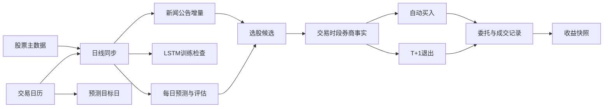

<!-- AI_GENERATE_START--- ----------- -->
# 自动真实交易执行设计

## 核心链路

系统只保留无人值守真实交易：

`收盘后数据同步 -> 离线 LSTM 更新 -> 新闻情感推理 -> 候选排名 -> Java 风控 -> 券商真实委托 -> 订单与成交留痕`

模型只生成候选和分数，不持有券商凭据，也不能直接调用券商接口。所有订单必须经过 `RealTradingService -> RiskController -> TradeExecutor -> ZXBrokerAdapter`。

## 执行门禁

自动委托必须同时满足：

1. 券商会话有效。
2. `TRADING_REAL_WRITE_ENABLED=true`。
3. 当日候选、可成交性、仓位、资金、T+1、止损和重复委托检查全部通过。

RealTradingService 只读取 StockSelector 返回的当天 ELIGIBLE 候选，并校验列表中的候选批次、预测批次和目标交易日一致。自动买入前通过 TradingCalendarService 再次确认当天为已确认交易日；候选为空、元数据缺失或批次混合时直接阻断。前端 /realTrading 页面展示交易门禁和完整候选追溯信息，不提供人工下单入口。

AutomaticTradeExecutionBatchService 使用 MySQL 唯一幂等键“执行类型 + 交易日”原子创建执行批次。RealTradingService 只有成功创建批次后才能读取持仓并提交委托，完成后记录处理数和成功数，异常时记录失败摘要。执行批次门禁与券商当日同方向订单检查同时保留，分别防止任务级重复执行和订单级重复下单。

真实写入门禁默认关闭，它是事故隔离开关，不是人工逐单审批。

## 固定任务

- `stockListSync`：`0 0 1 ? * SUN`，每周维护股票主数据。
- `tradeCalendarMonthlySync`：`0 10 4 1 * ?`，每月维护交易日历滚动窗口。
- `newsDailySync`：`0 0 5 ? * MON-FRI`，交易日前同步新闻公告。
- `dailyModelPrediction`：`0 15 6 ? * MON-FRI`，开盘前补齐全市场预测，并回填满足行情条件的历史评估数据。
- `stockSelection`：`0 30 6 ? * MON-FRI`，基于预测和情感生成候选。
- `realTradingAutoBuy`：`0 35 9 ? * MON-FRI`，执行买入门禁和买入流程。
- `broker-current-facts-sync`：`0 0/5 9-15 ? * MON-FRI`，交易时段每 5 分钟同步券商事实。
- `realTradingT1Exit`：`0 50 14 ? * MON-FRI`，执行止损、止盈和 T+1 退出检查。
- `daily-trade-performance-snapshot`：`0 0 16 ? * MON-FRI`，刷新交易收益快照。
- `dailyStockDataSync`：`0 0 18 ? * MON-FRI`，同步当日日线并递归回补最近三年缺口。
- `lstmOfflineTraining`：`0 0 19 ? * MON-FRI`，检查并受控更新共享 LSTM 模型。

任务配置由代码固定维护，不提供通用任务编排页面或在线 Cron 修改接口。Quartz 只负责固定任务的持久化触发、暂停恢复和调度生命周期；业务执行、交易门禁和执行审计由应用服务负责。任务运维接口允许查询固定任务状态、查询执行历史、手动触发全部已注册固定任务，以及按运行记录停止排队中或执行中的任务。

### 任务职责与业务编排



任务之间采用“固定时间触发 + 上游状态校验”的组合方式。Cron 只负责提供执行机会，不能代表上游已经成功。每个任务仍通过固定 Quartz Job 进入 `JobExecutionService`，再由业务 Service 执行门禁、幂等和结果记录。

删除的 8 个任务不再出现在 `JOB_CLASSES` 和 `job_config` 初始化目录中。低频单批重算和人工评估保留业务 Service/API；全量预测与评估补缺统一由 `dailyModelPrediction` 执行，策略自动切换、Agent 日报和交易计划自动执行不再拥有生产固定触发器。

## Quartz 调度设计

### 调度职责边界

```text
JobConfig 固定任务定义
    -> JobSchedulerService
        -> Quartz Scheduler
            -> 固定 Quartz Job
                -> JobExecutionService
                    -> 任务门禁
                    -> JobExecutionRecord
                    -> 业务 Job
```

- `JobConfig` 继续作为业务任务定义和固定白名单来源，任务时间由代码初始化。
- 每个固定任务使用独立 Quartz Job 类，并在 `JOB_CLASSES` 中维护 `jobName` 到 Job 类的一对一映射。
- 各任务 Bootstrap 在配置落库后立即幂等注册，主 Bootstrap 再进行一次全量注册，避免因初始化顺序导致配置存在但 Quartz 未注册。
- Quartz `JobDetail` 和 `Trigger` 使用稳定的 `jobName` 标识，应用启动时创建或更新。
- 固定 Quartz Job 由代码显式映射到 `jobName`，禁止从 HTTP 请求传递 Bean 名称、方法名或任意反射目标。
- `JobExecutionService` 统一承接定时触发和手动触发，保证两条路径使用相同门禁、互斥和审计逻辑。
- Quartz 内部状态用于调度生命周期；业务执行状态和历史记录写入独立的 `job_execution_record` 表。

### 任务运行状态

任务定义状态：

```text
ENABLED / DISABLED / PAUSED
```

任务运行状态：

```text
QUEUED / RUNNING / SUCCESS / FAILED / SKIPPED / REJECTED / CANCELLED
```

每次触发必须生成唯一 `runId`，不能通过覆盖 `job_config` 的最近一次字段替代执行历史。

### 执行记录字段

`job_execution_record` 至少包含：

```text
id
runId
jobName
triggerSource       SCHEDULED / MANUAL / RECOVERY
triggeredBy
scheduledTime
queuedTime
startedTime
finishedTime
durationMs
status
errorType
errorMessage
resultSummary
hostName
createdAt
```

错误信息只保存脱敏后的类型和摘要，不保存券商凭据、Token、密码或完整敏感请求参数。

### 管理接口

全部接口使用 `ResponseDTO<T>`，并在 Controller 入口记录业务日志：

```text
GET  /api/jobs
GET  /api/jobs/details/{jobName}
GET  /api/jobRuns
GET  /api/jobRuns/details/{runId}
POST /api/jobs/trigger/{jobName}
POST /api/jobs/pause/{jobName}
POST /api/jobs/resume/{jobName}
POST /api/jobRuns/stop/{runId}
```

- `GET /api/jobs` 返回任务定义、最近一次结果和当前业务运行状态。
- `GET /api/jobRuns` 支持任务名称、状态、触发来源、时间范围和分页条件。
- `POST /api/jobs/trigger/{jobName}` 允许触发全部已注册且已启用的固定任务，返回 `runId`。
- `POST /api/jobRuns/stop/{runId}` 取消排队任务或请求中断运行任务。
- 交易任务的手动触发仍必须复用真实交易门禁，不提供绕过业务风控的入口。
- 暂停和恢复只改变调度状态，不删除执行历史。

### 并发、恢复和错过触发

- 同一 `jobName` 默认禁止并发执行；需要允许并发的任务必须显式登记。
- Quartz 的 misfire 策略按业务任务配置：数据同步允许有限补偿，真实买入和退出任务禁止错过后自动补执行。
- 任务执行记录先写入 `QUEUED`，执行线程获得互斥权后更新为 `RUNNING`。
- `QUEUED` 用于异步受理、重复提交防护和开始执行前取消，不作为长期等待队列使用。
- 停止运行任务使用 Quartz 线程中断和执行记录取消双重机制；业务代码必须协作响应线程中断。
- 进程异常退出后，遗留的 `RUNNING` 记录由启动恢复检查标记为 `FAILED` 或 `CANCELLED`，具体结果必须保留恢复原因。
- 真实交易任务必须继续依赖 Java 风控、券商会话、真实写入总开关和业务幂等，Quartz 不得绕过这些门禁。

### 实施阶段

1. 增加 Quartz 依赖和调度配置，保留现有 `JobConfig` 固定任务初始化。
2. 增加 `JobExecutionRecord`、状态枚举、Repository、DTO 和分页查询接口。
3. 将现有 `JobSchedulerService` 改为 Quartz 注册、暂停、恢复和手动触发适配层。
4. 让定时触发和手动触发统一进入 `JobExecutionService`。
5. 完成应用重启、重复触发、任务失败、禁用任务和真实交易门禁验证。

## 框架选型保留意见

当前选择 Quartz 的原因是需要持久化调度生命周期、暂停恢复和后续多实例演进能力。但 Quartz 不负责业务执行记录、管理页面、权限、交易门禁或任务结果摘要，这些能力必须保留在应用层。

备选方案：

| 框架 | 适用场景 | 本项目结论 |
|---|---|---|
| Spring `ThreadPoolTaskScheduler` | 单节点、少量固定任务 | 改造量最小，但缺少持久化调度和集群能力 |
| Quartz | JDBC 持久化、misfire、暂停恢复、多实例 | 当前采用，执行历史仍由业务表维护 |
| XXL-JOB | 独立调度中心、Web 管理、分布式执行 | 当前部署规模偏小，新增中心组件成本较高 |
| PowerJob | 大量分布式任务、工作流和调度平台 | 能力超出当前需求，不建议现在引入 |
| ShedLock + Spring Scheduler | 保留 Spring 调度、只补多实例锁 | 可作为轻量替代，但仍需自行建设任务历史和管理接口 |

## 模型与通知边界

- 生产交易期间禁止训练或切换模型；交易时段外可在显式开关和门禁全部通过后执行训练。
- 开放专用的模型版本查询、训练触发、候选激活和上一版本回滚接口，不开放模型二进制编辑、任意下载或通用任务执行接口。
- 保留全市场共享 LSTM 的不可变历史版本、当前激活指针和上一回滚版本；不维护完整逐股模型。
- 通知只保留 `TradeNotificationPort` 扩展接口，当前空实现不发送 WebSocket、微信或其他外部消息。
- 订单、成交、异常和调度结果继续通过数据库及应用日志留痕。

## 验证边界

静态检查不能证明真实账户交易可用。启用真实写入前仍需在实际环境核验券商登录、资金、持仓、订单回查、T+1 和风控参数。

## 访问控制与运行配置归属

本模块同时承载交易执行所需的横向控制能力，但这些能力不改变四模块业务边界：

- 原 `com.stock.user` 已合并到 `tradingExecutor` 的 `api`、`domain`、`persistence`、`service` 和 `web` 目录，负责登录、会话、当前用户和请求拦截；认证成功只代表允许访问接口，不代表允许真实交易。
- 原 `com.stock.systemConfig` 已合并到 `tradingExecutor` 的 `api`、`domain`、`persistence` 和 `service` 目录，负责节点级调度、采集、新闻和模型训练开关；配置服务只暴露明确的门禁判断，不把完整配置实体传给其他模块。
- 调度类和执行记录类已提升到 `tradingExecutor` 根包，是固定任务和执行记录的唯一入口。`dataCollector`、`modelService`、`strategyAgent` 提供业务 Job 方法，但不自行管理 Quartz 生命周期。
- 真实写入开关、券商会话、交易时段、资金持仓和幂等检查必须在 `tradingExecutor` 内再次校验；认证或运行配置不能替代风控。

迁移已于 2026-10-13 完成：所有 import 已替换，旧顶层包已删除，接口路径 `/api/auth`、运行配置接口和数据库表保持兼容。认证拦截注册已从静态资源 `WebConfig` 中拆分到 `AccessWebConfig`。

## 设计简化

- 用户能力先只保留单用户登录、会话失效和最小访问拦截，不引入角色权限平台。
- 运行配置只保留非敏感开关；券商密码、Token 和真实写入凭据继续使用环境变量或受控密钥，不进入运行配置表。
- Quartz 只管理触发、暂停、恢复和 misfire；任务结果、业务门禁和审计由应用服务持久化。
- 交易执行只接受策略候选 DTO，不依赖策略模块的 Entity 或内部 Repository。

## 迁移验证结果

2026-10-13 已完成 `access`、`runtime` 包迁移、Java 17 全量编译和 Spring Boot 启动检查。启动过程中数据库节点配置恢复了 Quartz 运行状态并同步固定任务，说明运行配置优先级按设计生效；该行为也意味着临时命令行关闭开关不能覆盖已经持久化的节点配置。

## 静态验证边界

真实券商登录、订单回查、T+1 可卖数量、Quartz 故障恢复和运行配置并发更新仍需在目标环境独立验证。
<!-- AI_GENERATE_END-- ------------ -->
