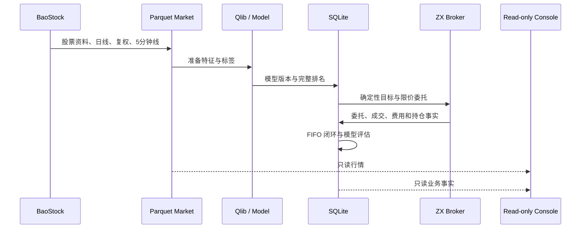

# 数据流与事实边界

## 事实来源

1. **BaoStock 原始数据**：股票资料、日线、复权因子和 5 分钟行情，落盘后作为研究输入。
2. **模型与排名制品**：Qlib 数据、模型目录、指标、完整横截面排名和回测结果。
3. **SQLite 运行状态**：任务、模型版本、预测排名、账户快照、委托尝试、券商订单、费用、权限、已实现交易、模型评估和重训请求。
4. **券商实时事实**：资金、持仓、五档行情、委托号、成交和撤单终态；优先级高于本地推测。
5. **日志与文档**：解释过程和设计，不替代业务事实。

## 主数据流

## 事实优先级

- 实时资金、持仓、报价和订单终态以券商返回为准。
- 预测排名只表示模型排序，不表示已经买入、成交或获利。
- 已实现收益只来自完整买卖闭环；未卖出持仓和账户总资产不计入策略收益。
- 模型制品、预测日期和 SQLite 模型版本必须保持绑定，不能把不同版本的结果混合评价。
- 文档与源码或数据冲突时，以当前源码和可核对事实为准，并把文档视为待修正内容。

## 写入与只读边界

Python 是 `data/` 的唯一写入方。它以 SQLite 事务、业务键和唯一约束保证命令重跑不会静默制造重复状态。Java 控制台通过 DuckDB 只读附加 SQLite、读取 Parquet，并使用只读卷挂载；它不执行 `INSERT`、`UPDATE`、`DELETE`，也不调用券商或 Python CLI。

## 数据质量门槛

`stock-collect`、`stock-prepare`、`stock-train` 和 `stock-rank` 使用统一覆盖率阈值，默认 `0.8`。覆盖率达标但存在缺失时记录警告并继续；低于阈值时明确失败。质量检查区分日线、复权因子和 5 分钟数据缺失，避免把“无数据”和“真实空值”混为一谈。
