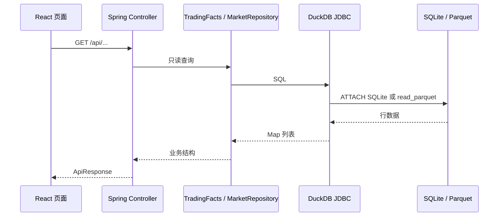

# 数据流与事实边界

## 三类事实源

1. `state/trading.db`：任务、模型版本、预测、订单尝试、券商订单、已实现交易、模型评估和训练请求。
2. `market/**/*.parquet`：股票目录、全市场日线、单股日线历史和 5 分钟行情。
3. 日志与 Markdown：运行过程证据、系统说明和历史设计背景。

## 查询链路

## 事实优先级

- 成交与收益以 `realized_trade` 和券商订单事实为准，不能用预测或计划代替。
- 当前持仓由已成交买单扣除已实现卖出数量推导，控制台不维护独立可写持仓表。
- 市场页面以最新可用 Parquet 分区为准；缺分区时返回空数据并携带可用性信息。
- 文档解释设计，不覆盖当前文件事实。文档与数据冲突时，页面应优先展示数据源事实，并把文档视为待更新说明。

## 只读保证

`TradingFacts` 在内存 DuckDB 中以 `ATTACH ... (TYPE sqlite, READ_ONLY)` 连接 SQLite；Parquet 通过 `read_parquet` 查询。控制台没有更新、插入、删除交易表的代码路径，Compose 数据卷也声明为只读。

## Agent 上下文

Agent 每次回答会组合最近对话、`agentSnapshot()` 业务快照和最多五条文档检索结果。证据引用包含 `duckdb:sqlite+parquet:read-only` 和命中的文档路径，因此回答应能区分实时文件事实与设计说明。
