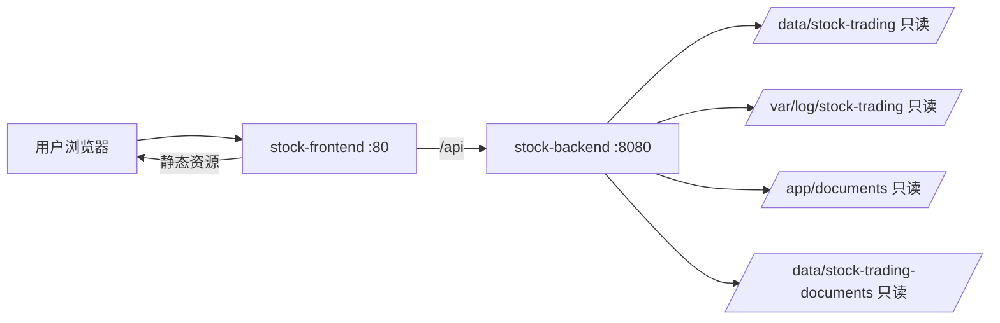

# 运行架构与组件边界

## 容器拓扑

生产 Compose 只包含 `stock-frontend` 和 `stock-backend` 两个应用容器。Frontend 使用 Nginx 暴露浏览器入口，Backend 仅绑定到宿主机回环地址；外部访问统一经过 Frontend 反向代理。

## 配置入口

`ConsoleProperties` 把运行配置收敛为五类：数据目录、任务日志、文档根目录、认证、Agent。默认本地数据目录为 `D:/stock-trading4/data`，容器环境通过 `STOCK_TRADING_VAR_DIR=/data/stock-trading` 替换。

| 环境变量 | 作用 |
|---|---|
| `STOCK_TRADING_VAR_DIR` | SQLite 与市场数据根目录 |
| `STOCK_TASK_LOG` | 系统日志文件 |
| `STOCK_DOCUMENT_ROOTS` | 多个 Markdown 根目录 |
| `CONSOLE_USERNAME` / `CONSOLE_PASSWORD_HASH` | 控制台认证 |
| `AGENT_ENABLED` / `DEEPSEEK_*` | Agent Provider 配置 |

## 构建边界

- Backend Dockerfile 使用 Maven 生成单个 `app.jar`，运行镜像为 Java 17 JRE。
- Frontend Dockerfile使用 Node 构建 Vite 资源，再复制到 Nginx。
- 前端构建阶段必须同时复制根 `documents/`，因为 PC 文档工作台通过 `import.meta.glob` 把 Markdown 编入只读前端资源。
- Backend 运行时还会索引挂载的文档，供文档 API 和 Agent 检索使用。

## 失败边界

数据文件缺失时接口返回空集合或 `available=false`，不把控制台启动失败等同于交易系统失败。Agent Provider 未配置或调用失败时会降级为本地只读摘要，但不会改变任何交易事实。
