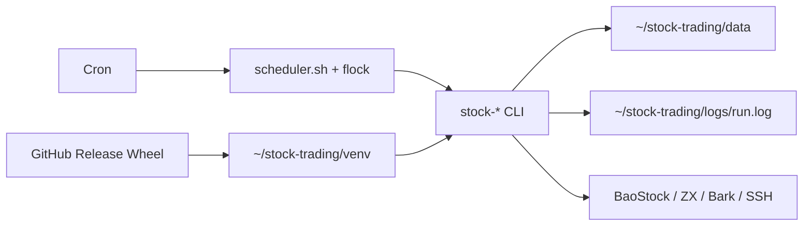
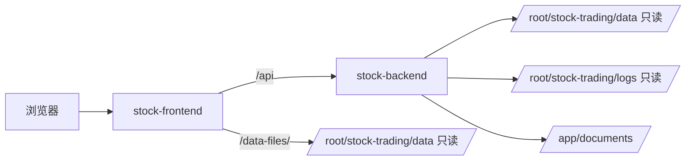

# 运行架构与组件边界

## Python 生产运行

生产主线不是常驻 Web 服务，而是一组安装在同一 Python 3.12 虚拟环境中的独立 CLI。Cron 在北京时间调用 `scheduler.sh`，脚本使用同一个非阻塞 `flock` 锁，避免行情、排名、交易、订单同步和复盘并发改写业务状态。



Linux 目录保持稳定：

```text
~/stock-trading/
├── venv/       # 当前运行环境
├── releases/   # 最近三个发布版本
├── data/       # 业务数据与状态
├── config/     # scheduler、Cron 与 logrotate 配置
├── *.env       # 按文件名顺序加载的环境配置
└── logs/       # 统一运行日志
```

## 公开命令边界

`pyproject.toml` 暴露以下公开入口：

- 数据与模型：`stock-collect`、`stock-prepare`、`stock-train`。
- 排名与交易：`stock-rank`、`stock-trading`。
- 订单与复盘：`stock-order`、`stock-review`。
- 维护与帮助：`stock-clean`、`stock-sync`、`stock-help`。

项目没有 `stock-init`。除 `stock-trading` 无参数时固定先卖后买、`stock-order` 内部完成订单同步与 FIFO 结算、`stock-review` 内部完成收益汇总与模型判断外，命令不会隐式启动其他业务阶段。

`stock-sync` 使用 SSH/SCP 同步 `market`、`qlib`、`model` 和只允许拉取的 `state`；它是运维数据搬运入口，不改变交易规则。

## 可选 Web 控制台拓扑

`stock-web` 分支使用两个容器：Nginx/React 对外提供页面和只读数据文件入口，Spring Boot 只绑定宿主机回环地址并读取 Python 数据与日志。



控制台通过 `STOCK_TRADING_DATA_DIR=/data/stock-trading` 对齐 Python 的 `data/`。本地默认值为 `D:/stock-trading4/data`，跨分支本地开发时可显式覆盖为实际 Python `data` 目录。

## 失败边界

- 某个 CLI 失败只记录对应任务与日志，不应伪造后续步骤成功。
- 数据质量低于统一阈值时，采集、准备、训练或排名在各自边界终止。
- 控制台缺少数据文件时返回空集合或不可用状态，不修复上游数据。
- Agent Provider 失败不改变 Python 交易事实。
- 发布成功只证明新版本已安装；行情、模型和真实交易仍需独立业务证据。
