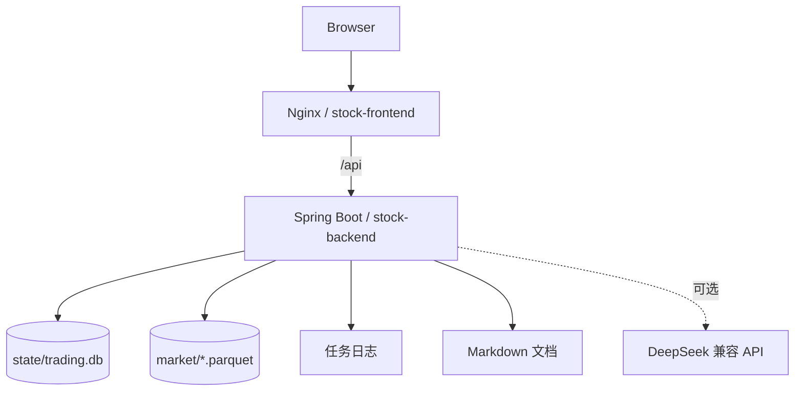

# 系统总览

## 业务目标

系统用于查看股票交易运行结果，而不是在控制台内创建第二套交易引擎。运营人员可以查看收益、行情、股票资料、历史委托、已实现交易、模型信息、系统日志和 Agent 对话；PC 端提供完整工作台，移动端只保留收益总览、交易记录、Agent 对话和系统日志四个高频入口。

## 系统边界

| 范围 | 当前职责 | 明确不做 |
|---|---|---|
| Python 交易系统 | 采集、训练、排名、计划、委托、事实回写 | 不在本仓库实现 |
| Java 控制台 | 只读查询 SQLite、Parquet、日志和文档 | 不写交易状态，不调度任务 |
| React 前端 | 展示、筛选、分页、图表、对话和文档 | 不直接读取宿主机文件 |
| Agent | 基于只读业务快照和文档回答 | 不执行交易、训练或修复 |

## 运行组成

`stock-backend` 使用 DuckDB JDBC 读取 SQLite 与 Parquet。Compose 把数据、日志和文档以只读卷挂载到容器中，Java 进程只负责查询和结构化响应。

## 前端平台边界

入口 `stock-client/src/App.tsx` 根据平台选择懒加载 `DesktopApp` 或 `MobileApp`。两端拥有独立路由、布局、页面组件和样式目录；共享内容仅限认证、主题、请求工具、国际化和少量无布局基础能力。

## 安全结论

- 会话 Cookie 为 `HttpOnly` 且 `SameSite=Lax`。
- 后端数据挂载是只读的，查询连接也以只读方式附加 SQLite。
- Agent 系统提示明确禁止声称已执行交易、训练、调度或数据修复。
- 文档内容来自版本库，不从用户输入执行 HTML；Markdown 渲染启用 `skipHtml`，Mermaid 使用严格安全级别。
