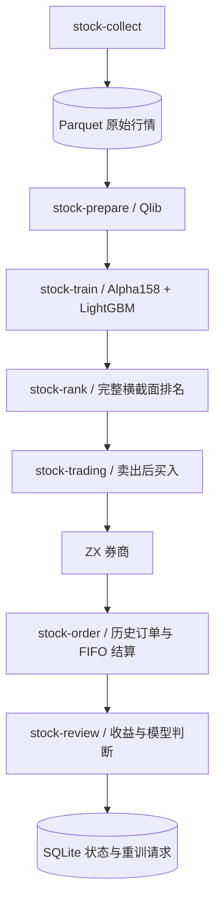

# 系统总览

## 业务目标

项目用于验证一条可审计的 A 股 T+1 模型交易链路：采集原始行情，生成可复现特征与排名，按确定性规则选择标的，通过券商协议执行委托，并只使用真实成交闭环评价策略表现。

模型负责评分和排序，不直接决定委托。股票范围、持仓轮换、资金计算、T+1 时序、报价、撤单、幂等和恢复均由确定性 Python 逻辑控制，券商是账户、持仓、委托和成交终态的最终事实来源。

## 系统边界

| 组成 | 当前职责 | 明确不做 |
|---|---|---|
| Python 核心 | 行情、研究、排名、交易、订单同步、交易复盘、数据同步和状态维护 | 不提供 Web 页面，不内置调度框架 |
| 操作系统调度 | 使用 Cron、`scheduler.sh` 与 `flock` 串行触发公开 CLI | 不在应用内维护 Quartz 或任务控制台 |
| Java 控制台 | 只读查询 SQLite、Parquet、日志和 Markdown | 不调用 Python CLI，不写交易库，不持有券商凭据 |
| React 前端 | 展示、筛选、图表、日志、Agent 和文档 | 不直接访问券商或宿主机文件 |
| Agent | 基于只读快照回答，或在受限仓库范围内生成代码提交 | 不生成交易委托，不绕过 Python 交易规则 |

## 主业务链路

## 数据与运行目录

Python 主线统一使用项目下的 `data/`：

- `data/market/`：股票资料、日线、复权因子、5 分钟线和 T+1 窗口聚合。
- `data/qlib/`：Qlib 日历、股票池和二进制数据。
- `data/artifacts/`：模型、指标、排名、回测和评估制品。
- `data/state/trading.db`：任务、模型、预测排名、账户快照、委托、券商事实、已实现交易和评估状态。
- `logs/run.log`：结构化运行日志。

Windows 源码运行使用仓库目录；Linux 生产固定使用 `~/stock-trading/`。应用按文件名顺序加载项目根目录的 `*.env`，后读取文件中的同名变量覆盖先读取文件和现有进程环境；缺少环境文件只告警，实际使用券商或同步功能时再校验必需变量。

## 可选控制台

`stock-web` 分支将 Python 数据目录和日志只读挂载给 Spring Boot，再由 React 提供 PC 与移动端页面。控制台是观察层，不是第二套交易系统；控制台不可用不等于 Python 交易主线失败，反之页面健康也不能证明行情、排名或真实交易已经成功。
