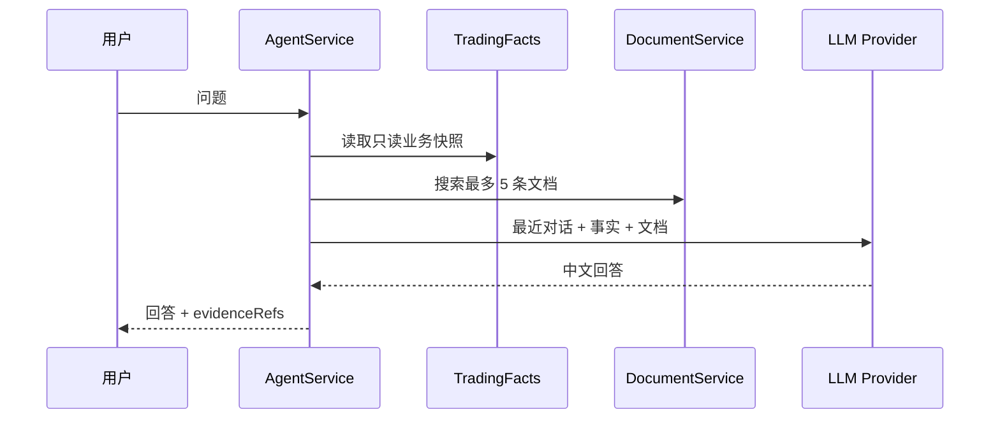

# Agent 对话与证据

## 当前能力

Agent 工作台包含两个严格分离的模式：运营对话模式是纯 Python T+1 系统的只读助手，用户可以围绕账户、持仓、委托、收益、模型、预测、任务和系统文档提问；自动开发模式只操作配置的 GitHub 代码仓库和目标分支，用于生成代码提交并触发发布工作流，不拥有交易数据或券商写权限。

## 回答链路

## 安全与降级

- 问题最大 4000 字符，同一会话串行执行。
- Provider 必须有合法 HTTP 地址和非空 API Key。
- Provider 未配置或调用失败时，返回本地只读摘要。
- 系统提示禁止声称已执行交易、训练、调度或数据修复。
- 会话存储当前位于 Java 进程内存，应用重启后不会保留。
- 自动开发默认关闭，只有 `GITHUB_AGENT_ENABLED=true` 且 Token、仓库和分支配置完整时才可执行。
- 自动开发提交前校验目标分支 HEAD，禁止强推，并禁止修改 `.github/workflows/**`。
- 自动开发任务保存提交 SHA、变更文件、构建轮次、工作流链接和失败原因，前端按任务编号轮询展示。

## 历史能力取舍

旧 Agent 平台曾包含独立 RAG 摄取、向量库、长期 Memory、工具目录、任务生命周期、预算、熔断、交易计划草案和人工审批。当前控制台只保留最小的会话、文档检索、业务快照和 Provider 调用，不再维护独立向量存储或可写交易工具。

保留的核心原则是：事实与说明分开、证据来源可追踪、失败可降级、运营 Agent 不拥有交易写权限；代码写能力只存在于受限的 GitHub 自动开发模式。
