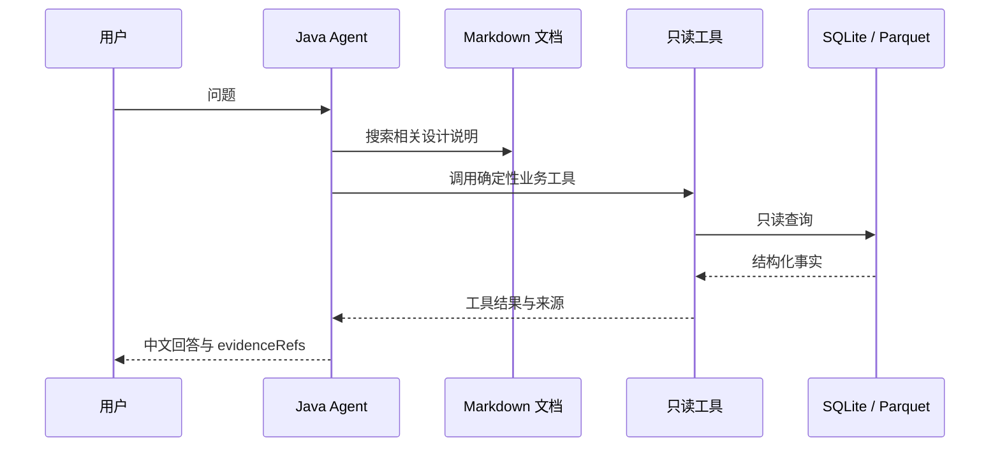

# 可选控制台 Agent 与证据

## 所属边界

Agent 只存在于 `stock-web` 分支，不属于 `stock-trading` 的 Python 交易运行链路。Python 的行情、排名、交易和评估不依赖 LLM，Agent 不会被 Cron 调用，也不能阻止或替代确定性业务命令。

## 两种模式

1. **运营对话**：组合最近会话、Markdown 检索和只读业务工具，回答账户、交易、收益、模型、预测、任务与系统设计问题。
2. **自动开发**：在明确配置的 GitHub 仓库和目标分支生成代码提交、等待 Actions，并在失败时进行有限轮次修复。

两种模式严格分离。运营对话没有代码写入能力，自动开发没有交易数据库、Python CLI 或券商访问能力。

## 证据链

## 安全与降级

- 同一会话串行执行，问题长度由后端限制。
- 会话和开发任务只保存在 JVM 进程内存；工具审计写入容器日志。
- 工具不接受任意 SQL、任意文件路径或交易写操作。
- Provider 未配置或失败时返回本地只读摘要，不改变任何业务状态。
- 自动开发默认关闭，禁止强推和修改 `.github/workflows/**`，提交前校验目标分支 HEAD。
- Agent 对交易的说明是 `ADVISORY_ONLY`，不能新增候选、改写排名、生成委托字段或调用券商。

历史 RAG 向量库、长期记忆、交易计划审批、独立 Agent 服务和可写交易工具均未恢复，不应出现在当前部署要求中。
