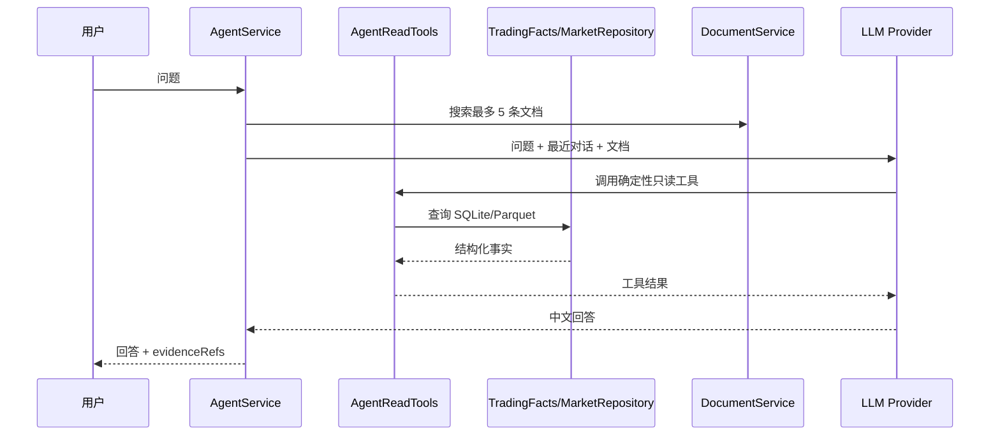

# Agent 对话与证据

## 当前能力

Agent 工作台包含两个严格分离的模式：运营对话模式由 Java 实现高级分析和工具编排，围绕账户、持仓、委托、收益、模型、预测、任务和系统文档提问；自动开发模式只操作配置的 GitHub 代码仓库和目标分支，用于生成代码提交并跟踪发布工作流。Python 只负责产生核心交易事实、模型产物和执行交易，Java Agent 不调用 Python CLI，也不拥有券商写权限。

## 回答链路

## 安全与降级

- 问题最大 4000 字符，同一会话串行执行。
- 会话和开发任务只保存在 Java 进程内存，应用重启后不保留；工具审计写入容器日志，不建立 Agent 数据库。
- 业务事实通过 Java Tool Calls 获取，当前提供收益汇总、闭环交易、模型快照、预测排名、失败任务、市场概览和交易决策证据。
- 收益工具只统计 `realized_trade` 已完成闭环，毛收益与扣费后净收益分开返回。
- 工具日期、分组和返回条数均进行白名单校验，不开放任意 SQL 或任意文件路径。
- Provider 必须有合法 HTTP 地址和非空 API Key。
- Provider 未配置或调用失败时，返回本地只读摘要。
- 系统提示禁止声称已执行交易、训练、调度或数据修复。
- 自动开发默认关闭，只有 `GITHUB_AGENT_ENABLED=true` 且 Token、仓库和分支配置完整时才可执行。
- 自动开发提交前校验目标分支 HEAD，禁止强推，并禁止修改 `.github/workflows/**`。
- 自动开发任务在运行期间保存提交 SHA、变更文件、构建轮次、工作流链接和失败原因；服务重启后从 GitHub 提交和 Actions 查询历史结果。
- 交易决策工具标记为 `ADVISORY_ONLY`，只能分析 Python 已生成的候选；不得新增证券、生成委托字段、改写排名或调用券商。

## 历史能力取舍

旧 Agent 平台曾包含独立 RAG 摄取、向量库、持久会话、长期记忆、任务生命周期、预算、熔断、交易计划草案和人工审批。当前控制台只保留进程内会话、文档检索、确定性只读工具和 Provider 调用，不维护 Agent 数据库、独立向量存储或可写交易工具。

保留的核心原则是：事实与说明分开、证据来源可追踪、失败可降级、运营 Agent 不拥有交易写权限；代码写能力只存在于受限的 GitHub 自动开发模式。旧 Python Agent/Wheel 方案已停止演进，高级 Agent 能力统一在 Java 层实现。
