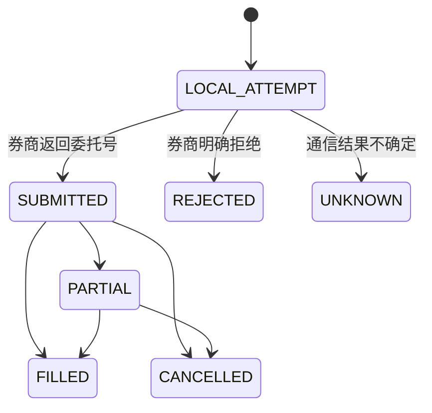

# T+1 交易闭环

## 当前说明边界

本页描述外部 Python 交易系统的业务契约，以及控制台能够读取的结果。交易执行源码不在本仓库中，因此时序属于历史设计保留的上游契约；当前仓库只能通过 SQLite 表和接口验证结果是否存在。

## 固定业务时序

```text
D-1 收盘后：更新行情、生成 D 日 Top 5
D 日下午：从可交易候选中生成并提交买入
D+1 日上午：卖出可卖持仓
D+1 收盘后：同步券商事实、计算已实现收益、更新模型评估
```

历史设计把标签定义为“D 日下午买入窗口到 D+1 日上午卖出窗口”的收益，而不是简单使用两个收盘价。分钟线为 5 分钟结束时间，窗口研究必须排除不完整落入执行区间的 K 线。

## 订单事实链



阶段 12 的最终取舍是“券商判断能否提交，本地记录结果”：正常提交不再等待成交或自动撤单；后续事实同步更新最终状态。`clientOrderId` 唯一约束仍用于阻止同一计划因重跑而重复提交。

## 控制台视图

- 历史委托：券商订单与尚未匹配券商单号的本地尝试合并展示。
- 交易记录：读取 `realized_trade`，展示买卖时间、数量、费用、毛利、净利和持有天数。
- 持仓：从未被已实现卖出完全覆盖的买入成交推导。
- 状态摘要：统计券商订单、本地尝试和已实现交易数量。

## 不能从控制台推断的内容

存在订单记录不代表已经成交；存在预测不代表生成了订单；空页面可能是数据文件缺失，也可能是真实业务为空。判断必须结合 `source.available`、状态字段和日志。
