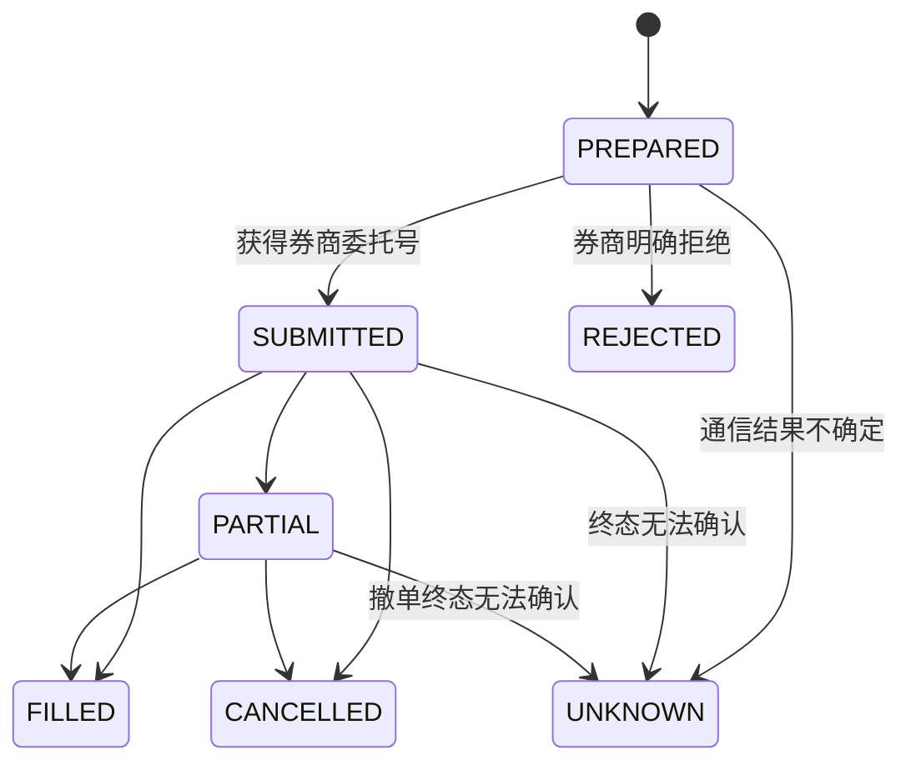

# T+1 交易闭环

## 日内时序

当前生产调度按北京时间执行：

| 时间 | 命令 | 业务动作 |
|---|---|---|
| 工作日 09:35 | `stock-trading` | 先卖出跌出 Rank15 或不在排名中的可卖持仓，再重新读取持仓并立即尝试买入 |
| 工作日 13:05 | `stock-trading --buy` | 下午买入重试；没有持仓时从最新完整排名 Top5 选择首个可交易候选 |
| 工作日 16:30 | `stock-collect -> stock-prepare -> stock-rank` | 更新行情、Qlib 和下一交易日使用的排名 |
| 工作日 20:20 | `stock-order -> stock-review` | 同步历史订单、FIFO 结算、汇总收益并评价模型 |

`stock-trading` 只处理上海时区当天，不接受历史日期参数。无参数或同时指定 `--sell --buy` 时固定先卖后买；也可使用 `--sell` 或 `--buy` 单独执行一个方向。

## 目标选择

- 默认只交易 `SH60`、`SZ00`，可通过环境变量调整允许前缀。
- 每个交易阶段开始前重新同步账户和持仓；卖出阶段完成后也会重新读取持仓，再决定是否买入。
- 已有持仓时跳过买入；同一业务日已有未拒绝买入目标时恢复原目标，不因为重跑改选另一只股票。
- 卖出数量来自券商实时可卖数量，买入数量按实时可用资金、限价、5 元基础费用和 100 股整手计算。
- 每次委托前重新读取账户、持仓和五档行情，不复用旧快照。

## 限价执行策略

单个买入或卖出窗口为 15 分钟，最多 12 次报价：

1. 前 50% 时间使用买三或卖三，优先控制成交价格。
2. 50%-85% 使用买一或卖一。
3. 最后 15% 跨到对手一档，提高成交概率。

每次委托使用独立 `clientOrderId`。提交后每 5 秒同步券商状态，单次最多观察 60 秒；仍未完全成交时先撤单，只有取得 `FILLED`、`CANCELLED` 或 `REJECTED` 等明确终态后才能重新报价。撤单已受理但 30 秒内无法确认终态时记录 `UNKNOWN`，停止危险重挂。

## 恢复与幂等

SQLite 保存目标、尝试号、业务键、券商委托号和状态转换。命令重启时先同步券商订单并恢复活动委托；已经成交的目标直接返回，存在活动委托时继续观察或撤单，不创建并行订单。

## 收盘后结算

`stock-order` 同步当天或指定范围的历史委托与成交，刷新交易权限，并按 FIFO 匹配买卖数量形成 `realized_trade`。`stock-review` 要求同一业务日 `ORDER` 任务成功，随后汇总完整闭环收益，并按月度已实现表现形成 `WARMUP`、`KEEP` 或 `RETRAIN`。

预测排名、委托尝试、券商订单和已实现交易是不同层次的事实，不能用其中任一层替代另一层。
