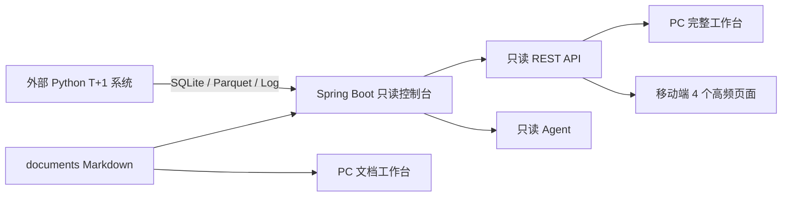

# 股票交易只读控制台文档工作台

本目录是当前系统的业务与代码说明。它吸收了历史提交中的系统架构、市场数据、模型、交易、Agent、前端、部署和阶段报告，但只保留仍能解释当前源码与数据契约的内容。已经删除的七模块 Java 交易后台、MongoDB/MySQL 主链、Quartz 交易调度、旧模型服务和独立 RAG 平台只作为历史演进记录，不再描述为现行能力。

## 当前系统定位

当前仓库是一个 **Java + React 的只读运营控制台**。它不执行训练、交易、调度或数据修复，而是读取外部 Python T+1 系统产生的 SQLite、Parquet 和日志文件，向 PC 与移动端提供不同的信息视图，并让 Agent 基于这些只读事实和本文档回答问题。

## 阅读路径

| 目标 | 建议入口 |
|---|---|
| 快速理解系统边界 | [系统总览](01-system/system-overview.md) |
| 理解数据如何进入页面 | [数据流与事实边界](01-system/data-flow.md) |
| 理解 T+1 业务 | [T+1 交易闭环](02-business/t1-trading-loop.md) |
| 理解前后端代码 | [Java 只读控制台](03-code/java-readonly-console.md)、[PC 与移动端隔离](03-code/frontend-dual-platform.md) |
| 理解部署和挂载 | [部署与数据挂载](04-operations/deployment-and-data-mounts.md) |
| 理解为什么采用当前方案 | [架构决策](05-decisions/adr-python-only-t1.md) |
| 查看历史设计如何收口 | [设计演进与取舍](06-history/retained-design-evolution.md) |

## 证据等级

- `SOURCE_VERIFIED`：已按当前源码、配置和历史提交进行文件级核对。
- `HISTORICAL`：只用于解释历史决策，不代表当前仍有对应实现。
- 本次文档重建未执行编译、测试、启动、容器或生产验证。
