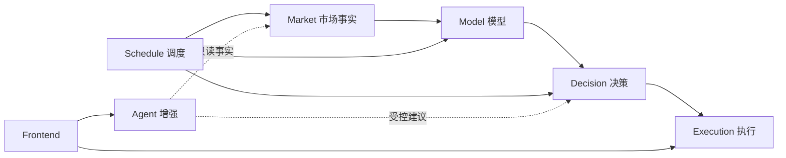

<DocMetadata />

**IDEA 工程入口**：[仓库说明 `README.md`](../README.md) · [文档站配置 `docusaurus.config.ts`](../stock-frontend/documentation/docusaurus.config.ts)

# 工程文档工作台

本门户统一管理系统架构、领域设计、专项方案、运行边界、运维说明和架构决策。代码实现仍是精确运行事实，文档负责解释边界、流程、原因和证据等级。

## 快速入口

| 入口 | 内容 |
|---|---|
| [系统总览](./system/project-overview.md) | 项目目标、三模块架构、业务闭环和部署关系 |
| [文档治理](./system/documentation-governance.md) | 文档层级、权威位置、状态和维护规则 |
| [Backend](./backend/index.md) | 六个业务领域、依赖方向和安全边界 |
| [Model](./backend/model/index.md) | 训练、推理、影子评估和自动调权 |
| [Agent](./agent/index.md) | 会话、RAG、Memory、工具和受控决策增强 |
| [Frontend](./frontend/index.md) | 页面、状态表达、接口分流和视觉约束 |
| [架构决策](./system/adr-001-docusaurus-documentation-portal.md) | 重要技术选择及其后果 |

## 阅读原则

- 从领域总览进入专题设计，再通过“关联源码”跳转到实现。
- `SOURCE_IMPLEMENTED` 只表示源码存在，不代表编译、运行或生产验证通过。
- 源码旁 README 是入口，详细设计以本门户正文为准。
- 类、方法和字段的局部契约以 Javadoc 和类型定义为准。
