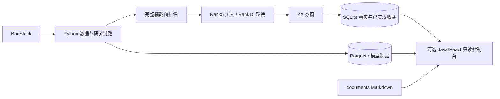

# 股票交易项目文档中心

本目录面向项目开发者和希望了解实现方式的读者，说明当前功能、技术方案、业务策略、运行边界和部署方法。文档以 `stock-trading` 分支的 Python 交易主线为业务事实来源，同时说明 `stock-web` 分支提供的 Java/React 只读控制台。

不再把历史 Java 交易后台、MySQL/MongoDB 主链、Quartz、旧多模型平台或可写交易 Agent 描述为现行能力。历史内容只保留仍能解释当前取舍的部分。

## 当前项目组成

| 分支 | 定位 | 主要职责 |
|---|---|---|
| `stock-trading` | 业务主线与生产权威 | BaoStock 采集、Parquet、Qlib、Alpha158、LightGBM、完整排名、T+1 交易、订单同步与结算、模型复盘、数据同步和 Wheel/Cron 发布 |
| `stock-web` | 可选只读控制台 | 读取 Python 产生的 SQLite、Parquet 和日志，提供 PC/移动端展示、文档工作台、只读 Agent 和受限 GitHub 开发 Agent |

## 推荐阅读路径

| 阅读目标 | 建议入口 |
|---|---|
| 十分钟理解项目 | [系统总览](01-system/system-overview.md) |
| 理解数据和事实边界 | [数据流与事实边界](01-system/data-flow.md) |
| 理解行情、模型与交易策略 | [市场数据与质量](02-business/market-data.md)、[模型与完整排名](02-business/model-and-ranking.md)、[T+1 交易闭环](02-business/t1-trading-loop.md) |
| 理解代码组织 | [Python 核心实现](03-code/python-core-implementation.md)、[Java 只读控制台](03-code/java-readonly-console.md) |
| 本地体验或生产安装 | [快速部署手册](04-operations/quick-deployment-guide.md) |
| 理解发布和调度 | [部署、发布与数据挂载](04-operations/deployment-and-data-mounts.md) |
| 理解关键架构取舍 | [Python 交易权威 ADR](05-decisions/adr-python-only-t1.md) |
| 查看历史方案如何收口 | [历史设计演进](06-history/retained-design-evolution.md) |

## 文档证据等级

- `SOURCE_VERIFIED`：已按当前两个分支的源码、配置和发布脚本进行文件级核对。
- `ACCEPTED`：已经采用并仍约束当前实现的架构决策。
- `HISTORICAL`：只解释历史背景，不代表仍有对应运行代码。
- 本次核对只进行了源码和文件检查，未执行编译、测试、启动、真实交易或生产验证。
