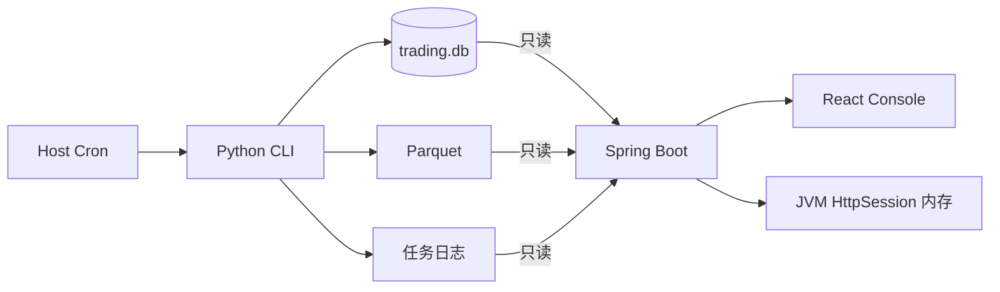

<!-- AI_GENERATE_START -- -->
# 控制台系统总览

## 定位

控制台只负责展示、统计、诊断、文档阅读和 Agent 问答。Python T+1 工程负责所有核心交易能力，Java 与 React 不构成第二套交易系统。

Java 磁盘写入为零。Agent 会话、消息和回答证据仅保存在当前登录的 JVM `HttpSession` 中，退出登录、Session 超时或服务重启后清理。PC 与手机使用不同登录 Session 时，对话不会同步。

单个登录 Session 最多保留 20 个 Agent 会话，每个会话最多保留 50 条消息；达到上限时淘汰最久未更新的会话或最早的消息。

## 页面

1. 概览：账户、持仓、绩效和最近异常。
2. 行情：股票目录和日 K。
3. 交易记录：委托、成交和持仓。
4. 模型与预测：版本、Top 5、评估和重训请求。
5. Agent：事实问答和文档检索。
6. 运行状态与日志：Cron 运行结果和固定日志文件。
7. 文档工作台：统一 Markdown 文档源。

## 禁止能力

控制台不包含交易提交、撤单、训练、预测触发、任务控制、券商同步、运行参数写入和 Python CLI 调用。
<!-- AI_GENERATE_END -- -->
