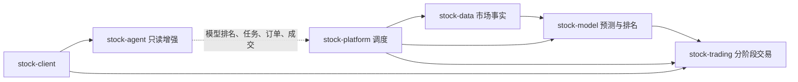

<DocMetadata />

# 工程文档工作台

本门户统一管理系统架构、模块职责、交易流程、运行边界、运维说明和架构决策。代码是精确运行事实，文档解释当前边界和证据等级。

## 快速入口

| 入口 | 内容 |
|---|---|
| [系统总览](./project-overview.md) | 七模块架构和模型驱动交易闭环 |
| [Backend 模块总览](../modules/后端模块总览.md) | 七个 Maven 子模块、依赖方向和事实边界 |
| [Model 模块](../modules/stock-model/模型模块.md) | 训练、推理、融合、评估和当日排名 |
| [Trading 模块](../modules/stock-trading/交易执行.md) | 上午卖出、下午买入、订单终态和券商事实 |
| [Platform 模块](../modules/stock-platform/任务调度.md) | 两项交易任务、Cron 和启停控制 |
| [Agent 模块](../modules/stock-agent/智能代理总览.md) | 会话、RAG、Memory 和只读事实查询 |
| [Frontend 模块](../modules/stock-frontend/前端设计.md) | 页面、路由和状态表达 |
| [部署与发布](../operations/部署与发布.md) | 运行拓扑、镜像、配置和验证边界 |

## 阅读原则

- `SOURCE_IMPLEMENTED` 只表示源码已实现或正在工作区实现，不代表编译、运行或生产验证通过。
- 根 `README.md` 是项目入口，模块详细设计以本门户为准。
- 已删除能力不在当前文档保留兼容说明或历史入口。
