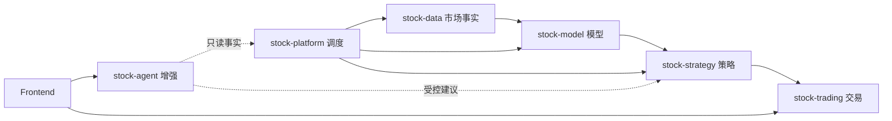

<DocMetadata />

# 工程文档工作台

本门户统一管理系统架构、领域设计、专项方案、运行边界、运维说明和架构决策。代码实现仍是精确运行事实，文档负责解释边界、流程、原因和证据等级。

## 快速入口

| 入口 | 内容 |
|---|---|
| [系统总览](./project-overview.md) | 项目目标、模块化单体架构、业务闭环和部署关系 |
| [Backend 模块总览](../modules/后端模块总览.md) | 八个 Maven 子模块、依赖方向和安全边界 |
| [Base 公共契约](../modules/stock-base/公共契约.md) | 最小公共响应与缓存名称契约 |
| [Model 模块](../modules/stock-model/模型模块.md) | 训练、推理、评估、晋级和回退 |
| [Agent 模块](../modules/stock-agent/智能代理总览.md) | 会话、RAG、Memory、工具和受控决策增强 |
| [Frontend 模块](../modules/stock-frontend/前端设计.md) | 页面、状态表达、接口分流和视觉约束 |
| [模型生命周期专题](../topics/modelLifecycle/ranking-lstm.md) | Ranking LSTM、模型融合与情感影子部署 |
| [部署与发布](../operations/部署与发布.md) | 运行拓扑、镜像、配置、CI/CD 和验证边界 |
| [文档治理](../governance/documentation-governance.md) | 文档层级、权威位置、状态和维护规则 |
| [架构决策](../decisions/adr-001-react-markdown-document-workbench.md) | 重要技术选择及其后果 |

## 阅读原则

- 从领域总览进入专题设计，再通过“关联源码”跳转到实现。
- `SOURCE_IMPLEMENTED` 只表示源码存在，不代表编译、运行或生产验证通过。
- 根目录 `README.md` 是项目入口，模块与源码包的详细设计以本门户正文为准。
- 类、方法和字段的局部契约以 Javadoc 和类型定义为准。
